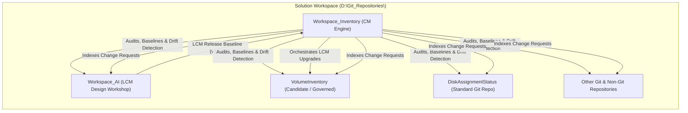

# Workspace_Inventory (Configuration Management System)

Module: Workspace_Inventory
Purpose: Authoritative Configuration Management (CM), multi-repository state tracking, LCM version lifecycle management, commit/push audit logging, and centralized Change Request (CR) management across `D:\Git_Repositories\`.
Path: D:\Git_Repositories\Workspace_Inventory\README.md
Authors: Rolf, Workspace_AI Engine
Version: 1.0.0
Date: 2026-08-15

---

## 1. System Overview

`Workspace_Inventory` serves as the operational Configuration Management (CM) system governing all sibling repositories and directories in `D:\Git_Repositories\` managed by `D:\VSCode-Workspaces\Solution.code-workspace`.



---

## 2. Key Responsibilities

1. **Repository Inventory & State Auditing**:
   - Discovers, categorizes, and tracks every child directory under `D:\Git_Repositories\`.
   - Distinguishes between `active-design-workshop`, `lcm-governed`, `standard-git`, `non-git`, `legacy-retired`, and `parent-infra`.
   - Records both `absorbed_lcm_version` (when onboarded) and `current_lcm_version`.

2. **Specialized Tracking for `Workspace_AI`**:
   - Monitors `Workspace_AI`'s 4 lifecycle states (`State1_ActiveWorkshop`, `State2_Verification`, `State3_ReleasedBaseline`, `State4_UnlockedProposal`).
   - Tracks the active global LCM release version.

3. **LCM Version Upgrades & Propagation**:
   - Safely upgrades repositories to the latest LCM version while preserving target `.lcm/overrides.json` and refreshing NTFS directory junctions.

4. **Commit & Push Audit Logging**:
   - Detects dirty working trees, untracked files, branch heads, and unpushed commits (`ahead`/`behind` relative to remotes).
   - Records CM events in an append-only audit trail.

5. **Central Change Request (CR) Management**:
   - Indexes and searches proposals across all repositories.

6. **Baselines & Drift Detection**:
   - Captures multi-repository snapshots and verifies against configuration drift.

---

## 3. CLI Tools & Common Workflows

```powershell
# Run a full workspace audit and regenerate the inventory dashboard
.\tools\Invoke-WorkspaceAudit.ps1

# Search for Change Requests across repositories
.\tools\Find-ChangeRequest.ps1 -Query "Inventory"

# Check workspace for configuration drift (dirty repos, outdated LCM, broken junctions)
.\tools\Test-WorkspaceDrift.ps1

# Launch isolated Beyond Compare 5 visual comparison against baseline
.\tools\Invoke-BeyondCompareReview.ps1 -RepositoryName "BootEntryManager"

# Record formal review outcome (Accepted, AcceptedWithEdits, Rejected, Deferred)
.\tools\Submit-ReviewResult.ps1 -RepositoryPath "BootEntryManager"
# (Or using the root alias: .\RR.ps1 BootEntryManager)

# Upgrade a target repository to the latest LCM baseline
.\tools\Invoke-LCMUpdate.ps1 -TargetRepository "VolumeInventory"

# Snapshot a new configuration management baseline
.\tools\New-WorkspaceBaseline.ps1 -BaselineId "BASELINE-v4.2.0"
```

---

## 4. Beyond Compare 5 Integration ("RR" Command)

You can wire the **`RR`** review result command directly into Beyond Compare 5 so you can record acceptance without leaving the diff window:

1. In Beyond Compare 5, navigate to **Tools** ➔ **Options** ➔ **Open With**.
2. Click **Add...** and configure:
   * **Description**: `LCM Review Result (RR)`
   * **Command**: `pwsh.exe -ExecutionPolicy Bypass -NoExit -File D:\Git_Repositories\RR.ps1 %p`
   * **Shortcut**: `Ctrl+Shift+R` (or your choice)
3. Now, while reviewing in Beyond Compare, pressing the shortcut opens the interactive review outcome menu directly.

---

## 5. Directory Layout

* `data/` - Machine-readable CM databases (`inventory.json`, `change_requests.json`, `baselines/`).
* `docs/` - Human-readable documentation, policies, and generated dashboards (`INVENTORY_DASHBOARD.md`).
* `logs/` - CM activity ledger (`cm_activity.log`).
* `modules/` - Reusable PowerShell CM modules (`WorkspaceCM.psm1`, `ChangeRequestManager.psm1`).
* `tools/` - Standalone executable PowerShell CLI tools.
