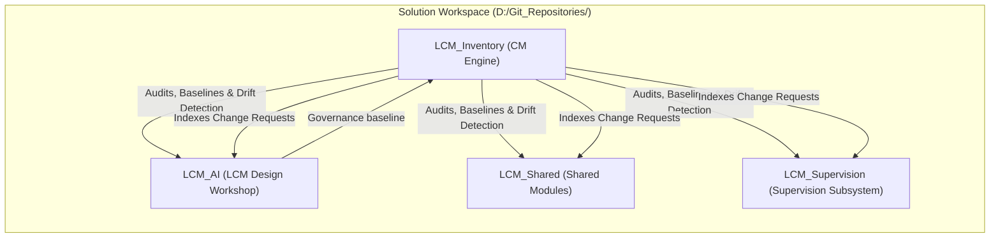

# LCM_Inventory (Configuration Management System)

Module: LCM_Inventory  
Purpose: Authoritative Configuration Management (CM), multi-repository state tracking, LCM version lifecycle management, commit/push audit logging, and centralized Change Request (CR) management across `D:\Git_Repositories\`.  
Path: D:\Git_Repositories\LCM_Inventory\README.md  
Authors: Rolf, LCM_AI Engine  
Version: 10.2.1
Date: 2026-10-18

---

## 0. Authoritative Tripartite Specifications

In compliance with [`DocumentationStandardsPolicy.md`](file:///D:/Git_Repositories/.agents/rules/DocumentationStandardsPolicy.md) (`RULE-DOC-001` - `003`), `LCM_Inventory` maintains three formal tripartite specifications:

1. **[Architecture Specification](docs/Architecture.md)**: End-user view, system topology diagrams, proposal lifecycle progression, and Beyond Compare review gate architecture.
2. **[Requirements Specification](docs/Requirements.md)**: Normative technical constraints, prerequisites, CM governance invariants (`RULE-REV-001` - `008`), and display standards compliance.
3. **[Implementation Specification](docs/Implementation.md)**: Directory layout, `WorkspaceCM.psm1` module cmdlets, tool scripts catalog, and canonical JSON schemas (`proposals.json`, `inventory.json`).
4. **[Consistency Analysis Operations](docs/AnalysisOperations.md)**: Repeat procedure, immutable evidence contents, and retention/cleanup rules for CON analysis runs.

---

## 1. System Overview

`LCM_Inventory` serves as the operational Configuration Management (CM) system governing all sibling repositories and directories in `D:\Git_Repositories\` managed by `D:\VSCode-Workspaces\Solution.code-workspace`.



**Diagram key:** `WI` = **LCM_Inventory** (Configuration Management engine);
`WAI` = **LCM_AI** (LCM design workshop); `LS` = **LCM_Shared** (shared
modules); and `LSP` = **LCM_Supervision** (supervision subsystem).

---

## 2. Key Responsibilities

1. **Repository Inventory & State Auditing**:
   - Discovers, categorizes, and tracks every child directory under `D:\Git_Repositories\`.
   - Distinguishes between `active-design-workshop`, `lcm-governed`, `standard-git`, `non-git`, `legacy-retired`, and `parent-infra`.
   - Records both `absorbed_lcm_version` (when onboarded) and `current_lcm_version`.

2. **Specialized Tracking for `LCM_AI`**:
   - Monitors `LCM_AI`'s 4 lifecycle states (`State1_ActiveWorkshop`, `State2_Verification`, `State3_ReleasedBaseline`, `State4_UnlockedProposal`).
   - Tracks the active global LCM release version.

3. **LCM Version Upgrades & Propagation**:
   - Safely upgrades repositories to the latest LCM version while preserving target `LCM_Inventory/overrides.json` and refreshing NTFS directory junctions.

4. **Commit & Push Audit Logging**:
   - Detects dirty working trees, untracked files, branch heads, and unpushed commits (`ahead`/`behind` relative to remotes).
   - Records CM events in an append-only audit trail.

5. **Central Change Request (CR) Management**:
   - Indexes and searches proposals across all repositories.

6. **Baselines & Drift Detection**:
   - Captures multi-repository snapshots and verifies against configuration drift.

---

## 3. CLI Tools & Common Workflows

For timestamped session error catalogs combining active-host evidence,
read-only lifecycle diagnostics, and recent action logs, see
[Session Failure Mode Analysis](docs/FailureModeAnalysis.md) (`AnalyzeFailures`).

```powershell
# Run a full workspace audit and regenerate the inventory dashboard
.\tools\Invoke-WorkspaceAudit.ps1

# Search for Change Requests across repositories
.\tools\Find-ChangeRequest.ps1 -Query "Inventory"

# Check workspace for configuration drift (dirty repos, outdated LCM, broken junctions)
.\tools\Test-WorkspaceDrift.ps1

# Launch the Macrium BCR review against the mounted baseline
.\tools\Invoke-MacriumBcrReview.ps1 -CRP "CRP-123" -RepositoryName "BootEntryManager"

# Record formal review outcome (Accepted, AcceptedWithEdits, Rejected, Deferred)
.\tools\Submit-ReviewResult.ps1 -RepositoryPath "BootEntryManager"
# (Or using the root alias: .\RR.ps1 BootEntryManager)

# Snapshot a new configuration management baseline
.\tools\Create-WorkspaceBaseline.ps1 -BaselineId "BASELINE-10.0.0"

# Generate the next immutable Level 1 evidence run and render the latest run in LCM Analysis Viewer
.\tools\Invoke-Level1AnalysisRefinement.ps1
.\tools\Show-LcmAnalysisViewer.ps1
```

---

## 4. Beyond Compare 5 Integration ("RR" Command)

You can wire the **`RR`** review result command directly into Beyond Compare 5 so you can record acceptance without leaving the diff window:

1. In Beyond Compare 5, navigate to **Tools** ➔ **Options** ➔ **Open With**.
2. Click **Add...** and configure:
   * **Description**: `LCM Review Result (RR)`
   * **Command**: `pwsh.exe -ExecutionPolicy Bypass -NoExit -File D:\Git_Repositories\RR.ps1 %p`
   * **Shortcut**: `Ctrl+Shift+R` (or your choice)
3. Now, while reviewing in Beyond Compare, pressing the shortcut opens the interactive review outcome menu directly.

---

## 5. Methodology & Authoritative Memory Anchors

The operational governance and lifecycle methodology of the platform are codified in the following authoritative specifications:

1. **[LCM Methodology & Memory Anchor](docs/LCM_METHODOLOGY_AND_MEMORY_ANCHOR.md)**:
   * **The DOX Invariant**: All documenting and executable assets are binding across the system; no code anywhere is exempt from visual review or Git tracking.
   * **The Ledger Invariant**: Historical audit logs (`LCM_Inventory/data/logs/lcm/`, `logs/cm_activity.log`) and visual review receipts (`data/reviews/`) are permanent system memory, strictly tracked and pushed for disaster recovery.
   * **Review Gate Separation**: Beyond Compare visual diff review is a human inspection gate, strictly distinct from Git `.gitignore`.
   * **Approach 1 Governance**: Physical tracking in `LCM_Inventory/.agents/` with virtual NTFS junctions at the root and child repositories.
   * **Restorable Snapshot Push Pipeline**: Pre-push rule compilation, catalog synchronization, ahead-detection, and `-DryRun` simulation.
   * **Browser Display Table Channel Compliance**: Port 9876 REST bridge daemon standard for all LCD tables.

2. **[CM Policies & Operating Procedures](docs/CM_POLICIES.md)**:
   * Formal lifecycle phases, branching and commit policies, review-gated promotion, history retention horizon ($M-2$), and CM Control Hub architecture.

---

## 6. Directory Layout

* `data/` - Machine-readable CM databases and generated artifacts only (`inventory.json`, `analysis/`, `proposals/`, `reviews/`, `baselines/`); executable tooling remains under `tools/`.
* `docs/` - Human-readable documentation, policies, methodology anchors, and generated dashboards (`LCM_METHODOLOGY_AND_MEMORY_ANCHOR.md`, `CM_POLICIES.md`, `INVENTORY_DASHBOARD.md`).
* `logs/` - CM activity ledger (`cm_activity.log`) and historical audit records.
* `modules/` - Reusable PowerShell CM modules (`WorkspaceCM.psm1`, `ChangeRequestManager.psm1`).
* `tools/` - Standalone executable PowerShell CLI tools (`Invoke-WorkspacePush.ps1`, `Invoke-MacriumBcrReview.ps1`, `Submit-ReviewResult.ps1`, etc.).
