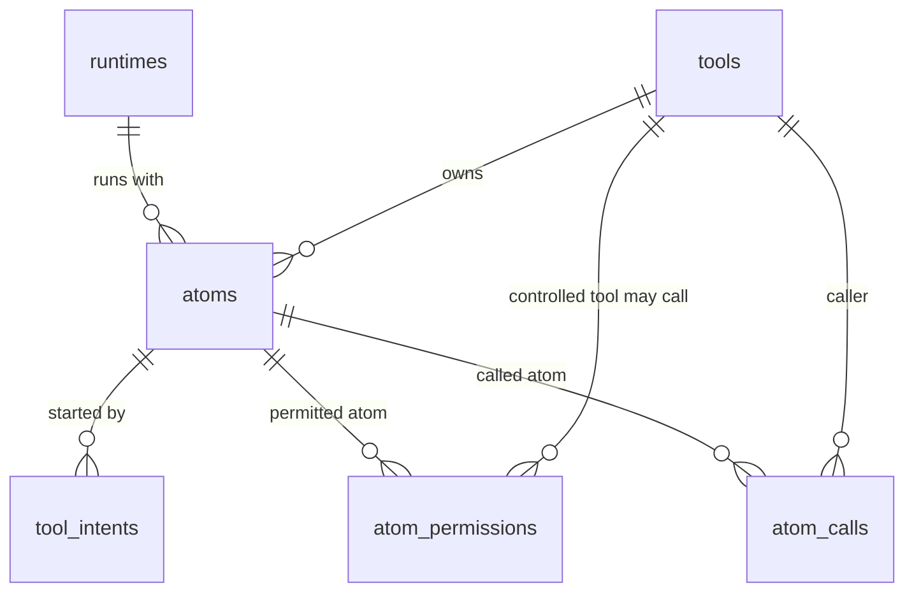

# Atom Data Design (Draft)

Module: data/analysis/CRP-363/DataDesign-Atoms-Draft.md  
Purpose: Draft data design for atoms as first-class records in tools.db (CRP-363 T1/T2), for operator review before any table change.  
Path: LCM_Inventory/data/analysis/CRP-363/DataDesign-Atoms-Draft.md  
Authors: Rolf, Claude  
Version: 10.7.4  
Status: Draft revision 2 (operator decisions 2026-11-19 applied; analysis only; nothing implemented)  
Date: 2026-11-19 17:31:25

---

## 1. Facts (tools.db read with mode=ro, 2026-11-19 17:31:25)

| Fact | Value |
|:---|:---|
| Intent rows (`tool_intents`) | 683 |
| Distinct scripts behind the intents | 330 |
| Intent keys per script (count of scripts) | 1: 61, 2: 195, 3: 66, 4: 6, 5: 2 |
| Scripts with a `tools` row of the same path | 330 (tools without any intent: 1) |
| Scripts whose intents disagree on `elevated` | 0 |
| Elevated scripts / their owner level | 85 / level 3: 85 |
| Tool levels (`tools.admin`) | 0: 2, 1: 240, 2: 3, 3: 86 |
| `tool_atom_permissions` rows | 6, keyed by intent key (not by script) |

Consequences:

- Today an atom is implicit: one script file = one `tools` row; the intents are aliases of it; elevation is repeated on
  every alias row of `tool_intents`.
- The permission list of a controlled tool names an intent alias, so the same atom can appear under different keys.
- The parameter column holds a JSON object of parameter names; the policy export takes a "required switch" only from a
  value that starts with `-`, so no atom currently carries a required switch (finding, not changed here).
- The CRP-358 reconciliation (data/analysis/CRP-358/) shows the catalog JSON carries `Aliases`, `Role`, `Domain`,
  `IntentElevated` without a column; `IntentElevated` is the atom elevation as declared in the catalog.

## 2. Proposed Model

Operator decisions 2026-11-19: (3) a tool may own several atoms (1:n, own key per atom); (4) the permission list
names atoms, and atom calls are recorded for all scanned calls. Still open: the required-switch catalog field (section 5).

### 2.1 Table `atoms` (new)

| Column | Type | Constraint | Meaning |
|:---|:---|:---|:---|
| `atom_id` | INTEGER | PRIMARY KEY | own key per atom (decision 3) |
| `script_path` | TEXT | NOT NULL | path relative to the git root, forward slashes |
| `entry_point` | TEXT | NULL | function or label inside the script; NULL = the whole script |
| `tool_id` | INTEGER | NOT NULL, FK `tools.id` | owning tool; a tool owns 1..n atoms (decision 3) |
| `elevated` | INTEGER | NOT NULL CHECK (elevated IN (0,1)) | the elevation authority (CRP-343) |
| `required_switch` | TEXT | NULL | parameter switch that narrows the elevation (e.g. `-Apply`) |
| `runtime_key` | TEXT | NULL, FK `runtimes.runtime_key` | interpreter (CRP-366); NULL for native executables |
| `archived_at` | TEXT | NULL | archive mark; rows are never deleted |
| `updated_at` | TEXT | NOT NULL | |

Keys and constraints: UNIQUE (script_path, entry_point) with NULL treated as one value (unique index on
`(script_path, COALESCE(entry_point, ''))`). Invariant (enforced by the generator and checked by the consistency
check): `elevated = 1` only when the owning tool has `tools.admin = 3`. Migration: today every script is one atom
(entry_point NULL) owned by the tool of the same file; `elevated` comes from `tool_intents.elevated` (consistent per
script today) and the catalog field `IntentElevated` where set.

### 2.2 Changes to existing tables (additive only, no field dropped)

- `tool_intents.atom_id` INTEGER FK `atoms.atom_id` (new column). `tool_intents.elevated` and `script` stay as
  columns but become derived from the atom (a view or the generator keeps them equal); the authority is `atoms.elevated`.
- `atom_permissions (tool_id FK tools.id, atom_id FK atoms.atom_id, PRIMARY KEY (tool_id, atom_id))` replaces the
  intent-keyed list (decision 4); `tool_atom_permissions` stays readable until its readers are switched (archive, not
  drop); the 6 current rows map to atoms as in section 2.4. The catalog field `AllowedAtoms` names atoms from then on.
- `atom_calls (caller_tool_id FK tools.id, atom_id FK atoms.atom_id, source_path TEXT, source_line INTEGER,
  PRIMARY KEY (caller_tool_id, atom_id, source_path, source_line))`: the full call graph (decision 4: all scanned calls,
  elevated or not), regenerated by the generator from its call scan; the consistency check and ShowAtoms read it.

### 2.3 Views

- `v_atoms`: one row per atom with owning tool, level as text (0 TBD, 1 granted, 2 controlled, 3 admin), elevated,
  required switch, intent keys (aggregated), permitted controlled callers, actual callers (`atom_calls`), conflict flag.
- `v_atom_conflicts`: the CRP-343 conflict rules evaluated in SQL (caller level vs atom elevation and permission list).

### 2.4 Current permission rows mapped to atoms

| Controlled tool | Level | Intent key (today) | Atom script |
|:---|---:|:---|:---|
| `LCM_Inventory/tools/Mount-MacriumLatestBaseline.ps1` | 2 | `invoke-macriummountworker` | `lcm_inventory/tools/invoke-macriummountworker.ps1` |
| `LCM_Inventory/tools/Invoke-MacriumDailyBcrBaseline.ps1` | 2 | `invoke-macriummountworker` | `lcm_inventory/tools/invoke-macriummountworker.ps1` |
| `LCM_Inventory/tools/Invoke-MacriumDailyBcrBaseline.ps1` | 2 | `set-lcmmachineregistry` | `lcm_inventory/tools/set-lcmmachineregistry.ps1` |
| `LCM_Tools/tools/AdminShell.ps1` | 2 | `disable` | `lcm_tools/tools/disable.ps1` |
| `LCM_Tools/tools/AdminShell.ps1` | 2 | `enable` | `lcm_tools/tools/enable.ps1` |
| `LCM_Tools/tools/AdminShell.ps1` | 2 | `uninstall` | `lcm_tools/tools/uninstall.ps1` |

## 3. Fit With The CRP-358 Target

- Tables are the only store: the catalog generator writes `tools`, `atoms`, `tool_intents`, `atom_permissions` and
  `atom_calls` directly; no catalog or intent JSON exists.
- The daemon's policy file stays a generated export from the tables (the Go daemon has no SQLite driver), now produced
  from `atoms` and `atom_permissions`.
- An SQL dump of `tools.db` precedes the schema change; the committed projection `tools.sql` carries the new tables.

## 4. ShowAtoms Display (content)

One row per atom (from `v_atoms`): script path, owning tool and its level as text, elevated (yes/no), required switch,
intent keys, permitted controlled callers, actual callers found by the scan, and a conflict marker with the rule that
fails. Filters: elevated only, conflicts only, by owning subsystem. Served on port 9876 like the other Show displays;
registered as a catalog intent and macro (`ShowAtoms`) per RULE-LCM-021.

`ShowToolIntents` (CRP-363 T4) then shows the level as text and the elevation from `atoms`, with a link to the atom row.

## 5. Decisions And Open Question

- Decided 2026-11-19: 1:n atoms with an own key; permissions by atom; full call graph.
- Open: required switch: an explicit catalog field (proposed, since the parameter column cannot express it), or stay
  derived from the parameter column (today no atom gets one)?
