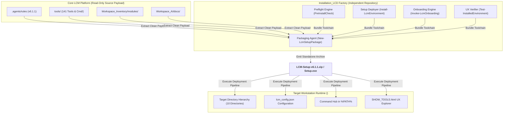

# Implementation Plan & Documentation Review - CRP: Installation_LCD Subsystem

## 1. Goal Description

Establish the complete **Documentation-First Design Suite** for the **`Installation_LCD`** repository (`D:\Git_Repositories\Installation_LCD`), providing full normative tripartite specifications (`Architecture.md`, `Requirements.md`, `Implementation.md`) and the universal installation runbook (`install/Installation.md`) for operator review directly within the IDE editor.

---

## 2. Proposal Registry Entry (Ticket-First Compliance)

In accordance with [`RULE-LCM-001`](file:///.agents/rules/ProposalReviewFlowPolicy.md) and [`RULE-LCM-007`](file:///.agents/rules/ProposalReviewFlowPolicy.md), this review and design stage is tracked in the proposal ledger:
- **Proposal ID**: `#16`
- **CR ID**: `CR-2026-027`
- **Origin Repo**: `Installation_LCD`
- **State**: `suggested`
- **Progress State**: `undecided`
- **Title**: *Design and Author Comprehensive Tripartite Specifications and Normative Runbook for Installation_LCD*
- **Plan Path**: `Workspace_Inventory/data/proposals/plans/Proposal-016_CR-2026-027_Plan.md`
- **Walkthrough Path**: `Workspace_Inventory/data/proposals/plans/Proposal-016_CR-2026-027_Walkthrough.md`

---

## 3. Full Tripartite Documentation & Design Review

As requested by the operator, the full normative specifications are presented below for standard IDE Editor review:

### A. Technical Architecture Specification ([`docs/Architecture.md`](file:///d:/Git_Repositories/Installation_LCD/docs/Architecture.md))

#### Key Architecture Decisions:
1. **Unidirectional Extraction**: `Installation_LCD` is an independent factory toolchain. Core LCD does not depend on or reference `Installation_LCD`, maintaining pure subsystem separation (`RULE-SUB-001`).
2. **10-Directory Standard Target Layout**: Deploys `<TargetRoot>\` with `.agents\rules`, `bin`, `Cmd`, `config`, `data`, `docs`, `lib`, `logs`, `tools`, and root maintenance `Setup.cmd`.
3. **Manifest Hand-off Contract**: `PreInstallCheck.ps1` serializes choices to `config/install_manifest.json`; `Install-LcmEnvironment.ps1` generates tailored `config/lcm_config.json`; `Test-InstalledEnvironment.ps1` validates active modules dynamically.
4. **Unified Continuous Logging**: All phases write continuously to `<TargetRoot>\logs\installation.log`.

---

### B. Requirements Specification ([`docs/Requirements.md`](file:///d:/Git_Repositories/Installation_LCD/docs/Requirements.md))

| Req ID | Title | Summary Specification |
| :--- | :--- | :--- |
| **REQ-INST-001** | Standalone Setup Deliverable | Compile complete platform into single self-contained archive (`LCM-Setup-v6.1.1.zip` / `Setup.exe`) with SHA256 manifest. |
| **REQ-INST-002** | Configurable Target Root | Fully decoupled destination root (`<TargetRoot>`), defaulting to `D:\Tools\LCM`. |
| **REQ-INST-003** | Interactive Preflight Audit | Audits OS build ($\ge 19041$), PowerShell 7, NTFS junctions, disk space, and UAC state. |
| **REQ-INST-004** | Modular Tool Selection | Interactive menu allowing inclusion/omission of `everything_search`, `ai_orchestration`, `beyond_compare`, `database_storage`, `desktop_daemon`, `web_dashboard_ux`. |
| **REQ-INST-005** | Manifest Hand-off | Serializes preflight state into `<TargetRoot>\config\install_manifest.json`. |
| **REQ-INST-006** | Target Environment Descriptor | Emits `<TargetRoot>\config\lcm_config.json` tailored with active components and endpoints. |
| **REQ-INST-007** | Unified Continuous Logging | Appends all operations to `<TargetRoot>\logs\installation.log` without truncation. |
| **REQ-INST-008** | Environment PATH Registration | Registers `<TargetRoot>\Cmd` in user `%PATH%` for global shell access. |
| **REQ-INST-009** | Live UX Verification | Executes tests and launches `SHOW_TOOLS.html` web dashboard in the browser. |
| **REQ-INST-010** | Conditional Verifier Skipping | Omitted tools are marked `SKIPPED (Omitted by Operator Choice)` with passing status. |
| **REQ-INST-011** | Dedicated Workspace Onboarding | Post-setup repository linking is isolated in `Invoke-LcmOnboarding.ps1`. |
| **REQ-INST-012** | Foreign Subsystem Exclusion | Excludes foreign repositories (`HaSSD06`, `HaSSD06_Inventory`) and temporary artifacts. |
| **REQ-INST-013** | Non-Interactive Automation | `-NonInteractive` parameter across all tools for headless/CI deployments. |

---

### C. Implementation Specification ([`docs/Implementation.md`](file:///d:/Git_Repositories/Installation_LCD/docs/Implementation.md))

- **Toolchain Components**:
  - `New-LcmSetupPackage.ps1` & `NewLcmSetupPackage.cmd` (Packaging Factory)
  - `PreInstallCheck.ps1` & `PreInstallCheck.cmd` (Modular Preflight Checker)
  - `Install-LcmEnvironment.ps1` & `Setup.cmd` (Setup Execution Engine)
  - `Invoke-LcmOnboarding.ps1` & `OnboardWorkspace.cmd` (Workspace Onboarding Tool)
  - `Test-InstalledEnvironment.ps1` & `VerifySetup.cmd` (Post-Installation UX Verifier)
- **JSON Schemas**: Standardized schemas for `install_manifest.json` and `lcm_config.json`.

---

### D. Normative 7-Phase Runbook ([`install/Installation.md`](file:///d:/Git_Repositories/Installation_LCD/install/Installation.md))

1. **Phase 1**: Package Extraction & Bootstrapping (`Setup.cmd`).
2. **Phase 2**: System Telemetry & Dependency Audit (`PreInstallCheck.ps1`).
3. **Phase 3**: Modular Tool Selection & Feature Provisioning (Interactive Checklist).
4. **Phase 4**: Core Platform Deployment (10-Directory staging via `Install-LcmEnvironment.ps1`).
5. **Phase 5**: Environment PATH & Runtime Configuration (`%PATH%` registration).
6. **Phase 6**: Post-Installation Verification & Live UX Launch (`SHOW_TOOLS.html`).
7. **Phase 7**: Multi-Repository Workspace Onboarding (`Invoke-LcmOnboarding.ps1`).

---

## 4. Verification Plan

1. **Document Standard Conformance (`RULE-DOC-001` - `004`)**:
   - Verify DOX headers, tripartite separation, and normative runbook compliance.
2. **Rule Health Diagnostic**:
   - Run `Test-LCMRuleHealth.ps1` to confirm `Installation_LCD` reports `🟢 In Compliance (v6.1.1)`.
3. **Workspace Readiness Quality Gate**:
   - Run `Workspace_AI/tools/Test-WorkspaceReadiness.ps1` (`Workspace_AI readiness self-test: OK`).

---

## 5. Review & Approval Gate

In accordance with [`RULE-LCM-001`](file:///.agents/rules/ProposalReviewFlowPolicy.md) and [`RULE-LCM-002`](file:///.agents/rules/ProposalReviewFlowPolicy.md), please review the design in this document and respond with **`do #16 Proposal`** (or click **Proceed**) to authorize implementation of the packaging and installer suite in `Installation_LCD`.

