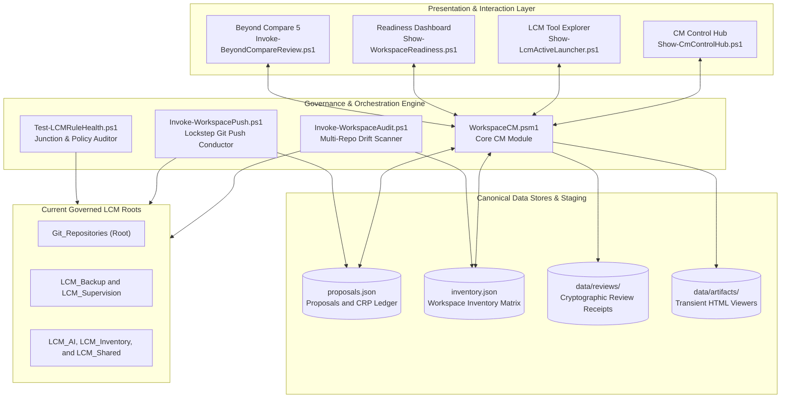
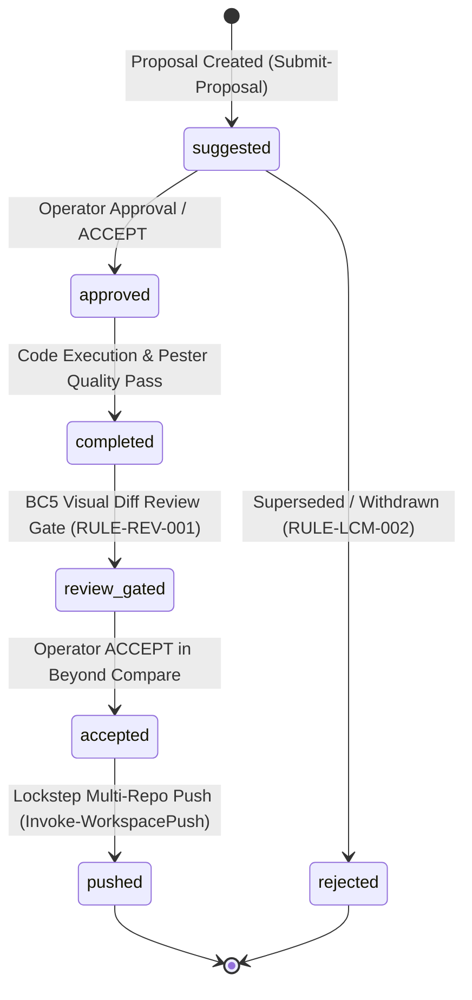
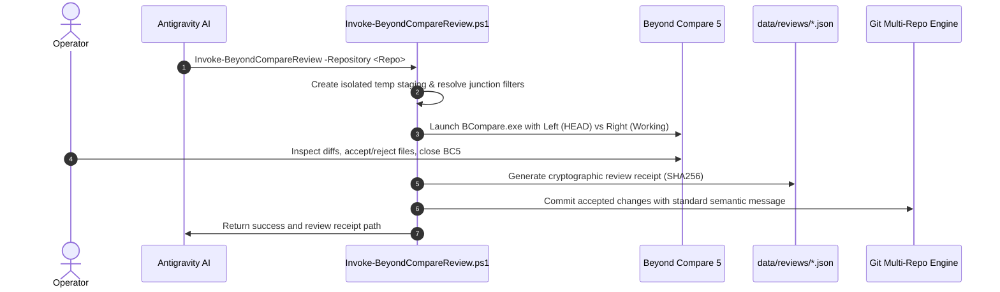
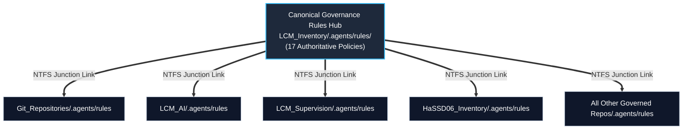

# Architecture Specification: Workspace Inventory & Configuration Management Control Hub

Module: docs/Architecture.md  
Purpose: Authoritative architectural specification for LCM_Inventory, the central Configuration Management (CM), proposal ledger, and review-gating engine of the Lifecycle Model (LCM).  
Path: D:/Git_Repositories/LCM_Inventory/docs/Architecture.md  
Authors: Rolf, LCM_AI Engine  
Version: 7.0.0  
Status: Authoritative Architecture  
Date: 2026-09-19  

---

## 1. System Overview & End-User Perspective

**`LCM_Inventory`** serves as the central operational hub and single source of truth for the entire Lifecycle Model (LCM) multi-repository ecosystem. It governs configuration tracking, change request proposal (CRP) state progression, multi-repository review gating via Beyond Compare 5, drift auditing, and multi-repo remote push orchestration.

From an operator and AI agent perspective, `LCM_Inventory` provides three primary interaction surfaces:
1. **Interactive UI Dashboards**: Fast, single-instance HTML/JS control hubs launched via local loopback web channels (e.g. CM Control Hub, Tool Explorer, Readiness Modal, Table Viewers).
2. **Deterministic CLI Tooling**: Modular PowerShell 7 automation scripts conforming to Microsoft approved verbs and universal `-h` help banners.
3. **Canonical Data Stores**: Schema-validated JSON ledgers (`proposals.json`, `inventory.json`, `tool_catalog.json`) maintaining immutable audit history and proposal lifecycle states.

---

## 2. Proposal Lifecycle & Recovery Progression

All modifications to workspace code, documentation, and configuration operate under a strict, non-bypassable proposal lifecycle:

### Proposal State Definitions:
- **`suggested`**: Formal proposal or change request (CRP) registered with structured scope and plan path.
- **`approved`**: Operator has granted explicit permission to proceed with implementation.
- **`completed`**: Code modifications implemented and verified through quality gates and Pester test suites.
- **`review_gated`**: Physical code changes staged in temporary isolation for operator side-by-side verification in Beyond Compare.
- **`accepted`**: Operator review complete; cryptographic review receipt generated in `data/reviews/` and changes committed to Git.
- **`pushed`**: Commits synchronized to remote GitHub repositories via `Invoke-WorkspacePush.ps1`.

### 2.1 Recovery Lifecycle Record

The canonical lifecycle record is a flat `state_reason` pair: `state` is the
current lifecycle value and `state_reason` is the operator or system reason for
that current value. The pair replaces competing lifecycle interpretations from
`progress_state` and `disposition`; retained legacy fields are display-only
compatibility data.

Existing `state_history` entries are immutable evidence. New lifecycle events
are appended only and may carry richer transition metadata (previous state,
reason, actor, timestamp, cohort, review/test scope, and linkage). They do not
rewrite historical records to fit the newer shape.

CRP bundles are temporary active-work specifications, not permanent duplicate
history. On a successful push, their delivered content is absorbed into the
repository baseline documentation and retained ledger/history evidence. If
further work is required, the same identifier reopens in `suggested` with a
new forward-only revision record rather than creating a replacement CRP solely
to revise the prior work.

### 2.2 Cohorts, Specifications, and Review Surfaces

A cohort coordination bundle may group repository and/or cohort work, exact
members, dependencies, semantic specification deltas, and shared verification.
It does not replace member history or permit ambiguous scope.

Baseline tripartite documentation defines durable behavior; an active CRP/BUG
specification defines the temporary delta. A semantic change to an active
specification restarts each affected CRP at `suggested`, records the delta, and
requires delta-only review and testing for the changed semantics. Unaffected
validated evidence remains intact.

Beyond Compare Review (BCR) is the primary visual review surface. `ShowCM` is
both the overview and the requested state-navigation surface: it must expose
state-appropriate accept/reject actions and repository, cohort, and complete
forms without inferring an ambiguous CRP-only scope.

---

## 3. Beyond Compare Review Gate Architecture

Per `RULE-REV-001` - `008` ([`ReviewCommitGovernancePolicy.md`](file:///D:/Git_Repositories/.agents/rules/ReviewCommitGovernancePolicy.md)), direct un-reviewed commits are prohibited. The review gating pipeline isolates changes, performs side-by-side verification, and audits all approvals:

---

## 4. Multi-Repository Governance & Junction Topology

`LCM_Inventory` holds the canonical physical storage for all 17 authoritative governance policies at `.agents/rules/`. All other repositories in the workspace link to this directory via single-hop NTFS junctions:

This topology ensures 100% rule discovery whether opening the root workspace container or any isolated child repository folder in IDE sessions.

<!-- FixDocumentation: CRP-196 Architecture -->
## 5. Proposed Documentation Reconciliation Service

`LCM_Inventory` hosts `Fix-Documentation.ps1` as the evidence-bound
documentation reconciliation service. It receives explicit CRP/BUG scopes,
resolves repository-qualified tripartite payloads, records manifests and
receipts, and dispatches per-repository BCompare review without changing
implementation or lifecycle state.
<!-- /FixDocumentation -->

## 6. ADMINMODE Rule-Change Authorization

Rule changes are privileged governance mutations, not ordinary documentation
edits. `ADMINMODE` gates them independently of process elevation:

1. The workspace initializes hidden ADMINMODE state when it opens.
2. The current user is eligible only when their Windows identity belongs to the
   local Administrators group (SID `S-1-5-32-544`).
3. An eligible user starts with ADMINMODE enabled and may use
   `Make-Admin -Mode On|Off`; a non-admin request leaves the state unchanged
   without interactive output.
4. Before review submission commits staged authority-rule paths, the
   governance engine verifies ADMINMODE for the same user SID.
5. Every initialization, enable/disable request, denial, and CRP rule-change
   authorization writes the current user, SID, CRP identifier, and affected
   rule paths to `logs/cm_activity.log`.

ADMINMODE is deliberately absent from standard dashboards and is not an
elevation signal. A non-elevated administrator may be authorized for rule
changes, while an elevated process without eligible Windows group membership is
not.
