# LCM Proposals Database Design Specification

Module: docs/DataDesign-Proposals.md  
Purpose: Authoritative data architecture, SQLite schema, constraints, views, and dual-state projection invariants for the LCM Proposals ledger.  
Path: D:/Git_Repositories/LCM_Inventory/docs/DataDesign-Proposals.md  
Authors: Rolf, LCM_AI Governance  
Version: 10.2.4  
Status: Authoritative Data Specification  
Date: 2026-11-20 21:35:08  

---

## 1. Executive Summary & Purpose

The **LCM Proposals Database** (`proposals.db`) serves as the high-speed relational store for all Change Request Proposals (CRPs), bug fixes (`BUG-nnn`), and review cohorts within the Lifecycle Model (LCM) architecture. Governed by `CRP-322`, this store implements the **Dual-State Projection Architecture**:
- **Binary Runtime Engine (`data/proposals/proposals.db`)**: High-performance local SQLite database (git-ignored per `RULE-REV-001`) enabling sub-millisecond query execution, indexed lookups, and version partitioning in `ShowCM`.
- **Textual Baseline (`data/proposals/proposals.sql` & `proposals.json`)**: Deterministic SQL and JSON ledger files committed to Git for transparent diffs, code reviews in Beyond Compare, and auditable history.

---

## 2. Table Schemas & Constraints

### 2.1 Table: `proposals`
Stores all lifecycle attributes, metadata, dates, and state transitions for each proposal.

```sql
CREATE TABLE IF NOT EXISTS proposals (
    id INTEGER PRIMARY KEY,
    crp_id TEXT NOT NULL UNIQUE,
    timestamp TEXT NOT NULL,
    title TEXT NOT NULL,
    origin_repo TEXT NOT NULL,
    cr_id TEXT,
    app_id TEXT,
    primary_app TEXT,
    affected_apps_json TEXT,
    state TEXT NOT NULL CHECK(state IN ('suggested', 'in_progress', 'verified', 'in_review', 'completed', 'pushed', 'held', 'withdrawn', 'rejected', 'superseded')),
    bundle_id TEXT NOT NULL,
    bundle_dir TEXT NOT NULL,
    docs_json TEXT NOT NULL,
    commit_sha TEXT,
    github_url TEXT,
    author TEXT NOT NULL,
    details TEXT,
    plan_path TEXT,
    walkthrough_path TEXT,
    priority INTEGER NOT NULL DEFAULT 8,
    gate1_accepted INTEGER NOT NULL DEFAULT 0 CHECK(gate1_accepted IN (0, 1)),
    gate1_accepted_at TEXT,
    dates_json TEXT NOT NULL,
    state_history_json TEXT NOT NULL,
    flow_mode TEXT NOT NULL DEFAULT 'standard',
    always_proceed INTEGER NOT NULL DEFAULT 0 CHECK(always_proceed IN (0, 1)),
    lcm_version TEXT NOT NULL,
    progress_state TEXT NOT NULL,
    disposition TEXT,
    created_at TEXT NOT NULL DEFAULT CURRENT_TIMESTAMP,
    updated_at TEXT NOT NULL DEFAULT CURRENT_TIMESTAMP
);
```

#### Constraints & Data Integrity:
- **`id` (PRIMARY KEY)**: Strict sequential integer proposal identifier (`RULE-LCM-012`).
- **`crp_id` (UNIQUE)**: Canonical string identifier (`CRP-nnn` or `BUG-nnn`).
- **`state` (CHECK)**: Enforces valid lifecycle states conforming to `ProposalReviewFlowPolicy.md` (`RULE-LCM-007`).
- **`lcm_version` (NOT NULL)**: Version tag (e.g. `10.2.3`) enabling partitioning between active series and historical baselines.
- **`gate1_accepted` (BOOLEAN CHECK)**: Binary flag (0 or 1) enforcing authoritative Gate 1 specification acceptance.

---

### 2.2 Table: `review_cohorts`
Maintains atomic multi-proposal and cross-repository synchronization groups (`RULE-LCM-009`).

```sql
CREATE TABLE IF NOT EXISTS review_cohorts (
    id TEXT PRIMARY KEY, -- e.g. 'COH-321'
    state TEXT NOT NULL CHECK(state IN ('open', 'closed')),
    prime_proposal_id INTEGER NOT NULL REFERENCES proposals(id),
    proposal_ids_json TEXT NOT NULL,
    repositories_json TEXT NOT NULL,
    created_at TEXT NOT NULL,
    updated_at TEXT NOT NULL,
    closed_at TEXT
);
```

---

### 2.3 Tables: `strategies`, `strategy_crps` (CRP-358 strategies step, 2026-11-20)

```sql
CREATE TABLE IF NOT EXISTS strategies (strategy_id TEXT PRIMARY KEY, title TEXT, description TEXT, state TEXT,
    created_at TEXT, updated_at TEXT);
CREATE TABLE IF NOT EXISTS strategy_crps (strategy_id TEXT, crp_id TEXT, goal_role TEXT);
```

- The tables are the only strategy store; `data/proposals/strategies.json` is retired and deleted.
- `strategies.sql` is the publish projection (written at push with `proposals.sql`); `--action hydrate` rebuilds both after a pull (git hooks `post-checkout` / `post-merge`).
- Readers: `Show-Strategies.ps1` (`--action export-strategies`, read-only), `Test-LcmStrategyConsistency.ps1` (`--action check-strategies`).

### 2.4 Planned: Ledger Without Blobs (CRP-358 proposals step; accepted, not yet implemented)

Design status: accepted by the operator 2026-11-20 21:35:08; column lists and DDL in
`data/analysis/CRP-358/DataDesign-Proposals-NoBlob-Draft.md` section 5. Prose columns live as `.md` files under

```mermaid
erDiagram
    proposals ||--o{ proposal_null_columns : "null columns"
    proposals ||--o{ proposal_values : "list values"
    proposals ||--o{ proposal_dates : "lifecycle dates"
    proposals ||--o{ proposal_state_history : "history"
    proposals ||--o{ proposal_documents : "document paths"
    proposals ||--o{ proposal_events : "audit objects"
    proposals ||--o{ proposal_texts : "prose files"
    proposal_texts ||--|| BUNDLE_BLOB_FILE : "two-way link"
    proposals ||--o{ review_cohorts : "prime of"
    review_cohorts ||--o{ review_cohort_members : "members"
    proposals ||--o{ review_cohort_members : "member in"
    review_cohorts ||--o{ review_cohort_repositories : "repositories"
    review_cohorts ||--o{ review_cohort_gates : "gate history"
    review_cohort_gates ||--o{ review_cohort_gate_members : "member lists"
    review_cohorts ||--o{ review_cohort_audit : "completion audit"
    proposals ||--o{ review_obligations : "obligations"
    review_obligations ||--o{ review_obligation_reasons : "observed reasons"
    strategies ||--o{ strategy_crps : "links"
    proposals ||--o{ strategy_crps : "linked by"

    proposals {
        INTEGER id PK
        TEXT crp_id UK
        TEXT title
        TEXT state
        TEXT progress_state
        TEXT bundle_dir
        TEXT created_at
        TEXT pushed_at
        TEXT more_scalars "about 50 typed columns"
    }
    proposal_null_columns {
        TEXT crp_id PK,FK
        TEXT column_name PK
    }
    proposal_values {
        TEXT crp_id PK,FK
        TEXT column_name PK
        INTEGER seq PK
        TEXT value
    }
    proposal_dates {
        TEXT crp_id PK,FK
        TEXT state PK
        INTEGER seq
        TEXT at
    }
    proposal_state_history {
        TEXT crp_id PK,FK
        INTEGER seq PK
        TEXT state
        TEXT timestamp
        TEXT user
        TEXT note
    }
    proposal_documents {
        TEXT crp_id PK,FK
        TEXT source PK
        TEXT kind PK
        TEXT path
    }
    proposal_events {
        TEXT crp_id PK,FK
        TEXT event PK
        TEXT key PK
        INTEGER seq
        TEXT value
        TEXT value_kind
    }
    proposal_texts {
        TEXT crp_id PK,FK
        TEXT column_name PK
        TEXT file_path UK
    }
    BUNDLE_BLOB_FILE {
        TEXT path "docs/Proposals/_blobs/nnn_CRP-ID/column_name.md"
        TEXT frontmatter "CRP-ID, column_name"
    }
    ledger_settings {
        TEXT key PK
        TEXT value
        TEXT value_kind
        TEXT updated_at
    }
    review_cohorts {
        TEXT cohort_id PK
        INTEGER prime_proposal_id FK
        TEXT state "one open"
        TEXT created_at
        TEXT closed_at
    }
    review_cohort_members {
        TEXT cohort_id PK,FK
        INTEGER proposal_id PK,FK
        INTEGER seq
    }
    review_cohort_repositories {
        TEXT cohort_id PK,FK
        TEXT repository PK
        INTEGER seq
    }
    review_cohort_gates {
        TEXT cohort_id PK,FK
        INTEGER gate_seq PK
        TEXT gate
        TEXT required_state
        TEXT timestamp
    }
    review_cohort_gate_members {
        TEXT cohort_id PK,FK
        INTEGER gate_seq PK,FK
        TEXT list PK
        INTEGER seq PK
        INTEGER proposal_id
        TEXT detail
    }
    review_cohort_audit {
        TEXT cohort_id PK,FK
        TEXT key PK
        INTEGER seq
        TEXT value
        TEXT value_kind
    }
    review_obligations {
        TEXT obligation_id PK
        INTEGER proposal_id FK
        TEXT repository
        TEXT status
        TEXT bcr_identity
    }
    review_obligation_reasons {
        TEXT obligation_id PK,FK
        INTEGER seq PK
        TEXT reason
    }
    strategies {
        TEXT strategy_id PK
        TEXT title
        TEXT state
    }
    strategy_crps {
        TEXT strategy_id FK
        TEXT crp_id FK
        TEXT goal_role
    }
```

`docs/Proposals/_blobs/<nnn>_<CRP-ID>/`, linked both ways (`proposal_texts` row -> file; file frontmatter `CRP-ID` + `column_name` -> row).



`ledger_settings` stands alone (ledger-wide values). `strategies` / `strategy_crps` are implemented (section 2.3).

## 3. Indexing Strategy

Targeted B-Tree indexes ensure sub-millisecond filtering and zero table-scan penalties across all UI views:

```sql
CREATE INDEX IF NOT EXISTS idx_proposals_state ON proposals(state);
CREATE INDEX IF NOT EXISTS idx_proposals_version ON proposals(lcm_version);
CREATE INDEX IF NOT EXISTS idx_proposals_origin_repo ON proposals(origin_repo);
CREATE INDEX IF NOT EXISTS idx_proposals_progress_state ON proposals(progress_state);
CREATE INDEX IF NOT EXISTS idx_cohorts_state ON review_cohorts(state);
```

---

## 4. Views & Virtual Queries

### 4.1 View: `v_active_proposals`
Filters proposals belonging to the active LCM series (`10.2.x`), hiding historical versions (`10.0.x`, `10.1.x`, legacy) to optimize Control Hub rendering.

```sql
CREATE VIEW IF NOT EXISTS v_active_proposals AS
SELECT 
    id, crp_id, title, origin_repo, state, priority, 
    gate1_accepted, lcm_version, progress_state, updated_at
FROM proposals
WHERE lcm_version LIKE '10.2.%'
ORDER BY id DESC;
```

### 4.2 View: `v_version_summary`
Summarizes proposal counts partitioned by LCM version series.

```sql
CREATE VIEW IF NOT EXISTS v_version_summary AS
SELECT 
    lcm_version,
    COUNT(*) AS total_proposals,
    SUM(CASE WHEN state = 'completed' THEN 1 ELSE 0 END) AS completed_count,
    SUM(CASE WHEN state IN ('suggested', 'in_progress', 'verified', 'in_review') THEN 1 ELSE 0 END) AS active_count
FROM proposals
GROUP BY lcm_version
ORDER BY lcm_version DESC;
```

---

## 5. Tools & Synchronization Utilities

| Tool | Path | Responsibility |
| :--- | :--- | :--- |
| **`sync_proposals_db.py`** | [`tools/sync_proposals_db.py`](file:///D:/Git_Repositories/LCM_Inventory/tools/sync_proposals_db.py) | High-speed synchronization between `proposals.json`, `proposals.db`, and `proposals.sql`. |
| **`Sync-LcmProposalsDb.ps1`** | [`tools/Sync-LcmProposalsDb.ps1`](file:///D:/Git_Repositories/LCM_Inventory/tools/Sync-LcmProposalsDb.ps1) | PowerShell wrapper and CI/CD quality gate validation script. |
| **`Invoke-ProposalAction.ps1`** | [`tools/Invoke-ProposalAction.ps1`](file:///D:/Git_Repositories/LCM_Inventory/tools/Invoke-ProposalAction.ps1) | Primary CLI dispatcher mutating proposal states, cohorts, and triggering database sync. |
| **`Test-LcmProposalsDb.Tests.ps1`** | [`tests/Test-LcmProposalsDb.Tests.ps1`](file:///D:/Git_Repositories/LCM_Inventory/tests/Test-LcmProposalsDb.Tests.ps1) | Pester verification suite validating schema, constraints, and dual-state sync parity. |
