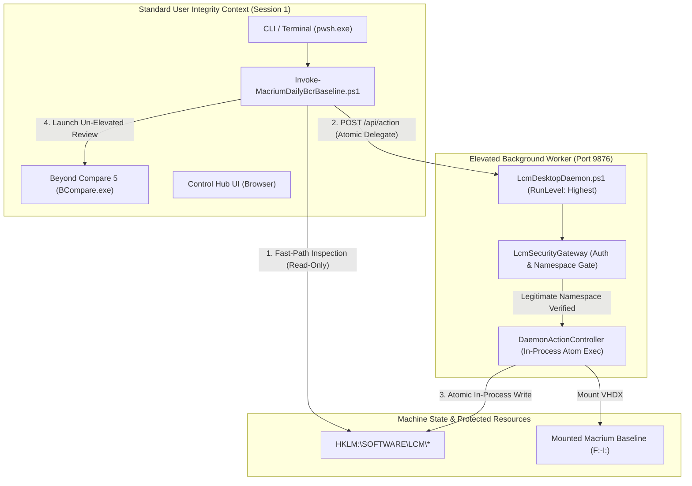
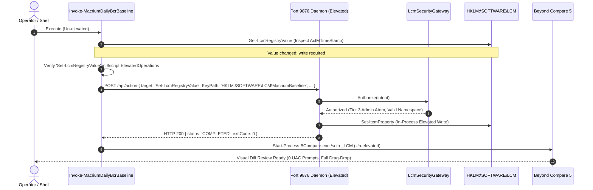
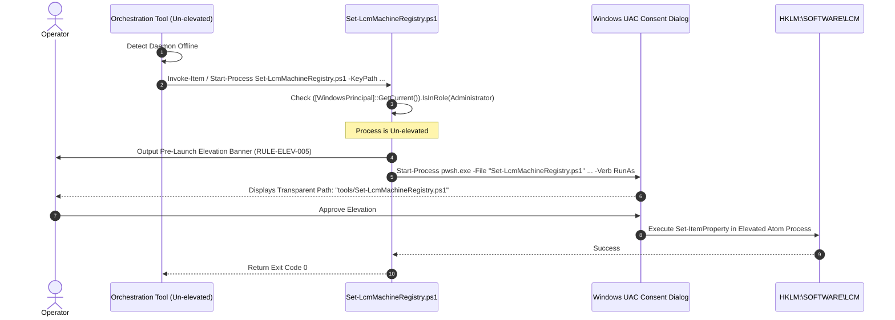

# Implementation Specification: Security & Atomic Elevation Architecture in LCM

Module: docs/Implementation of Security in LCM.md  
Purpose: Comprehensive technical specification of the Atomic Elevation Architecture, Security Gateway, privilege boundaries, and access controls in the Lifecycle Model (LCM).  
Path: D:/Git_Repositories/LCM_Inventory/docs/Implementation of Security in LCM.md  
Authors: Rolf, LCM_AI Engine  
Version: 10.2.0  
Status: Authoritative Implementation Specification  
Date: 2026-11-09 12:55:00  

---

## 1. Executive Summary & General Goals

The **Lifecycle Model (LCM)** governs multi-repository workspaces where developers, automated background processes, and AI coding assistants collaborate. Because certain operations require administrative operating system privileges (such as persisting machine-wide telemetry to `HKLM`, mounting virtual disk images, or reconfiguring system services), LCM enforces an **Atomic Elevation Architecture** that balances system security, developer velocity, and human transparency.

### Core Security Invariants

1. **Principle of Least Privilege (`RULE-ELEV-001`)**:
   - Normal workspace interactions—including Git operations, proposal lifecycle management, script execution, and test runs—must execute in a standard, un-elevated user context.
2. **Anti-GUI Poisoning Invariant**:
   - Graphical User Interface (GUI) applications—specifically diff tools like Beyond Compare (`BCompare.exe`), code editors (Notepad++, VS Code), and web browsers—must **never** run under an elevated administrator token.
   - *Rationale*: Running GUIs elevated triggers Windows User Interface Privilege Isolation (UIPI), breaking drag-and-drop from Windows Explorer. Furthermore, files created or edited by an elevated GUI inherit `Administrators` ownership and restricted ACLs, poisoning normal developer git workflows.
3. **Atomic Elevation Principle (`RULE-ELEV-007`)**:
   - When a composite orchestration script (such as `Invoke-MacriumDailyBcrBaseline.ps1`) requires a privileged action, elevation must **never** be widened to the parent process.
   - Elevation is strictly confined to the specific **atomic operation** (e.g., writing one machine registry key or mounting an image). The parent orchestration script and all spawned review GUIs remain 100% un-elevated.
4. **Single-Hive Machine Registry Authority**:
   - Machine telemetry resides exclusively in `HKLM:\SOFTWARE\LCM\*` (or machine environment variables under `HKLM\SYSTEM\CurrentControlSet\Control\Session Manager\Environment`).
   - Ad-hoc redirection or fallback to `HKCU` is strictly prohibited. If machine registry access is denied, the operation must fail transparently or report a gap rather than silently writing to user hives.
5. **Prohibition of Opaque UAC Prompts (`RULE-ELEV-005`)**:
   - The human operator must **never** be presented with an obscure `-EncodedCommand <base64>` in a Windows UAC elevation consent dialog.
   - All elevated invocations must target named, human-readable script files with transparent, visible arguments (e.g. `pwsh.exe -File tools/Set-LcmMachineRegistry.ps1 -KeyPath ...`).

---

## 2. Privilege Architecture & Integrity Tiers

LCM divides workspace execution into three distinct privilege tiers:

| Tier | Component | Process Token | Primary Responsibilities |
| :--- | :--- | :--- | :--- |
| **Tier 1: Standard User Space** | CLI scripts, Antigravity IDE, `BCompare.exe`, Git, Browser Control Hub | Standard User (`rgbig`) | Daily development, diff reviews, proposal transitions, read-only baseline checks. |
| **Tier 2: Elevated Desktop Daemon** | `LcmDesktopDaemon.ps1`, `DaemonActionController.ps1` | Elevated User (`rgbig` with `RunLevel: Highest`) | Listens on `http://127.0.0.1:9876`. Receives typed `ActionIntent` DTOs. Executes authorized atomic writes without modal UAC dialogs. |
| **Tier 3: Standalone Elevated Atoms** | `Set-LcmMachineRegistry.ps1`, `LcmMacriumAtoms.psm1`, `Invoke-PrivilegedTool.ps1` | Elevated Child Process (`Start-Process -Verb RunAs`) | Fallback execution when daemon is offline or explicit out-of-band administration is required. Spawns with pre-launch banner and transparent CLI arguments. |

### 2.1 Daemon Lifecycle: Automated Logon Startup & Elevation Boundedness

To eliminate repetitive daily elevation confirmations while preserving least-privilege invariants:

1. **Automatic Logon Startup (`AtLogOn` Trigger)**:
   - The daemon is registered as a single-owner Windows Scheduled Task (`LCM_DesktopDaemon_$env:USERNAME`) configured with `RunLevel: Highest` and `LogonType: Interactive`.
   - When the operator logs into Windows, Task Scheduler launches `pwsh.exe -File tools/LcmDesktopDaemon.ps1 -Port 9876` under the user's administrative token **without triggering any interactive UAC consent prompts**.
   - This provides an immediately available, elevated local REST worker on `127.0.0.1:9876` from the moment the desktop session begins.
2. **Maintenance & Mid-Session Restarts**:
   - If the daemon is terminated for code updates, killed, or stopped via `POST /stop`, all orchestration tools continue functioning via:
     - **On-Demand Task Restart**: Standard user scripts can restart the elevated daemon at any time by invoking `Start-ScheduledTask -TaskName "LCM_DesktopDaemon_$env:USERNAME"` (which requires zero elevation prompts because the task definition is already approved).
     - **Direct Atom Fallback**: If the daemon port remains offline, scripts seamlessly fall back to Tier 3 standalone atom execution (`tools/Set-LcmMachineRegistry.ps1`), surfacing a single transparent UAC prompt.
3. **Bounded Recovery**:
   - The task definition includes bounded restart settings (3 retries with 1-minute intervals) to recover from transient crashes without spawning unconstrained runaway processes.

### 2.2 Universal Command Gateway (`lcm do`), Pure Trampolines & In-Script Self-Governance

To eliminate fragile, ad-hoc elevation boilerplate across hundreds of scripts:

1. **Pure Trampoline Architecture (`*.cmd`)**:
   - Trampolines must never perform administrative checks, environment sniffing, or execution decisions (`net session >nul`).
   - A trampoline's sole invariant is:
     a) Verify that the target script exists on disk (if not, exit `1` with a human-readable missing script error).
     b) Forward execution and all command-line arguments (`%*`) directly to `lcm do <ToolName> %*`.
2. **Universal Parameter Serialization**:
   - Parameters passed from trampolines or CLI invocations are ingested by `Invoke-LcmAction.ps1` (`lcm do`), converted into a structured `DaemonActionIntent` DTO (handling switch flags, strings, integers, and parameter objects), and transmitted over HTTP POST to Port 9876.
   - The daemon's `ExecuteActionIntent` dynamically inspects `tool_catalog.json`. If the tool requires `Admin: true`, it executes elevated inside Session 1; if standard user, it executes un-elevated.
3. **Self-Sufficient In-Script Elevation Interception**:
   - When a PowerShell script (e.g. `Dismount-MacriumCurrentBaseline.ps1`) is executed directly via `pwsh.exe` without going through a trampoline, the script must not assume elevation or stall on unhandled UAC prompts.
   - The script body checks its current security token (`Test-IsAdmin`). If running un-elevated, it intercepts execution and automatically delegates itself to `lcm do <ToolName> @PSBoundParameters`, returning the exact exit code and streaming output transparently.

---

## 3. Detailed Control Flow & Code Mapping

### 3.1 Scenario A: Atomic Delegation via Elevated Desktop Daemon (Happy Path)

When an un-elevated tool needs to write machine telemetry, it delegates exclusively that atom to the elevated daemon.

### 3.2 Scenario B: Daemon Offline / Direct Standalone Fallback

If the desktop daemon is unreachable, the tool delegates to the standalone transparent atom script.

---

## 4. Code Implementation Mapping

| Security Function | Implementation File | Architectural Role & Governing Rule |
| :--- | :--- | :--- |
| **Immutable Allowlist Declaration** | [`tools/Invoke-MacriumDailyBcrBaseline.ps1`](file:///d:/Git_Repositories/LCM_Inventory/tools/Invoke-MacriumDailyBcrBaseline.ps1#L26-L35) | Declares `$script:ElevatedOperations` with `-Option ReadOnly -Scope Script`. Prevents runtime tampering (`RULE-ELEV-007`). |
| **Namespace Legitimacy Gate** | [`tools/Invoke-MacriumDailyBcrBaseline.ps1`](file:///d:/Git_Repositories/LCM_Inventory/tools/Invoke-MacriumDailyBcrBaseline.ps1#L110-L125) | Validates `HKLM:\SOFTWARE\LCM\*` regex pattern; rejects any external target hive. |
| **Redundant Write Elision** | [`tools/Invoke-MacriumDailyBcrBaseline.ps1`](file:///d:/Git_Repositories/LCM_Inventory/tools/Invoke-MacriumDailyBcrBaseline.ps1#L126-L132) | Compares current registry value against desired value; skips elevation entirely if identical. |
| **REST Security Gateway** | [`modules/LcmDaemon/Classes/LcmSecurityGateway.ps1`](file:///d:/Git_Repositories/LCM_Inventory/modules/LcmDaemon/Classes/LcmSecurityGateway.ps1) | Evaluates token credentials, origin IP (127.0.0.1 only), target tool existence in `tool_catalog.json`, and records audit receipts. |
| **In-Process Atomic Execution** | [`modules/LcmDaemon/Classes/DaemonActionController.ps1`](file:///d:/Git_Repositories/LCM_Inventory/modules/LcmDaemon/Classes/DaemonActionController.ps1#L318-L380) | Directly modifies `HKLM:\SOFTWARE\LCM\*` when running elevated; rejects un-elevated writes without opaque subprocess spawning. |
| **Transparent UAC Dispatch** | [`modules/LcmDaemon/Classes/DaemonActionController.ps1`](file:///d:/Git_Repositories/LCM_Inventory/modules/LcmDaemon/Classes/DaemonActionController.ps1#L286-L310) | Strictly forbids `-EncodedCommand` with `-Verb RunAs`. Formats transparent `-File` argument lists (`RULE-ELEV-005`). |
| **Standalone Atomic Registry Atom** | [`tools/Set-LcmMachineRegistry.ps1`](file:///d:/Git_Repositories/LCM_Inventory/tools/Set-LcmMachineRegistry.ps1) | Self-contained, elevated worker script with structured CLI parameters, namespace validation, and pre-launch notification banner. |
| **Elevated Daemon Task Registration** | [`tools/Register-LcmDesktopDaemon.ps1`](file:///d:/Git_Repositories/LCM_Inventory/tools/Register-LcmDesktopDaemon.ps1#L168-L230) | Registers `LCM_DesktopDaemon_rgbig` Scheduled Task with `<RunLevel>HighestAvailable</RunLevel>`, elevating transparently if needed. |
| **Quality Gate Verification (Gate 6/6)** | [`tools/Test-GeneralReadiness.ps1`](file:///d:/Git_Repositories/LCM_Inventory/tools/Test-GeneralReadiness.ps1#L180-L245) | Static AST analysis certifying immutability (`-Option ReadOnly`), `.NOTES` documentation, anti-GUI poisoning, and catalog synchronization. |

---

## 5. Use Cases Covered and Verified

### UC-1: Un-Elevated Fast-Path Daily Baseline Verification
- **Scenario**: Operator executes daily morning routine (`Invoke-LCM_GoodMorning.ps1` or `Invoke-MacriumDailyBcrBaseline.ps1`).
- **Behavior**:
  - The tool checks mounted drive `H:` and queries `HKLM:\SOFTWARE\LCM\MacriumBaseline`.
  - Because it runs un-elevated, execution completes in **<300ms**.
  - Beyond Compare 5 opens instantly in standard user space.
  - Explorer drag-and-drop works seamlessly.

### UC-2: Transparent Machine Registry Persistence
- **Scenario**: A new Macrium baseline is generated or drive mapping changes, requiring machine telemetry update.
- **Behavior**:
  - `Invoke-MacriumDailyBcrBaseline.ps1` verifies the target key path is in `HKLM:\SOFTWARE\LCM\*`.
  - It checks `$script:ElevatedOperations` to confirm `Set-LcmRegistryValue` is authorized.
  - It POSTs to `http://127.0.0.1:9876/api/action`.
  - The elevated daemon writes to `HKLM:\SOFTWARE\LCM\MacriumBaseline` directly in-process.
  - Zero UAC prompts appear; the operation logs an audit entry to `logs/cm_activity.log`.

### UC-3: Rejection of Unauthorized Registry Targets
- **Scenario**: A misconfigured script or malicious payload requests a write to `HKLM:\SAM` or `HKLM:\SYSTEM\CurrentControlSet\Services\...`.
- **Behavior**:
  - `DaemonActionController` evaluates the key path against the authorized regex:
    `^(?i)HKLM:\\SOFTWARE\\LCM(?:\\[^\\]+)*$`
  - Request is immediately blocked with HTTP `403 Forbidden` (`status: DENIED`).
  - An audit violation is recorded to `logs/audit_security.jsonl`.

### UC-4: Eradication of Opaque `-EncodedCommand` UAC Dialogs
- **Scenario**: A tool or operator triggers out-of-band elevation via the daemon or CLI.
- **Behavior**:
  - `DaemonActionController` checks if the command is a transparent `.ps1` script file.
  - If a base64 encoded command is supplied, it is rejected with a `403` error.
  - If an authorized script is dispatched, Windows UAC displays the clean, transparent path to the script file rather than a suspicious encoded string.

### UC-5: Quality Gate Enforcement at Gate 2 Review
- **Scenario**: A developer introduces a new elevated script or attempts to make `$ElevatedOperations` mutable.
- **Behavior**:
  - `Test-GeneralReadiness.ps1` Gate 6 scans the repository.
  - If `$ElevatedOperations` is declared without `-Option ReadOnly` or `Constant`, the gate **FAILS**.
  - If the operation is not documented in `.NOTES` or missing from `tool_catalog.json`, the gate **FAILS**.
  - No commit or review acceptance is permitted until parity is restored.

---

## 6. Limitations, Boundaries & Environmental Constraints

> [!WARNING]
> **Windows Task Scheduler Elevation Requirement**:
> An un-elevated user token cannot register a Scheduled Task with `RunLevel: Highest`. Executing `Register-LcmDesktopDaemon.ps1 -Install` will trigger a single transparent UAC prompt to allow Windows to register the task with administrative privileges. Once registered, the task starts automatically at logon with zero subsequent prompts.

> [!NOTE]
> **Headless & CI Environment Boundaries**:
> The Session 1 Desktop Daemon requires an interactive Windows desktop session. In headless CI pipelines or containerized testing environments:
> 1. Tests must execute in-process with mock registry providers, OR
> 2. The test runner must execute in an already-elevated runner container where `Set-LcmRegistryValue` executes directly in-process.

> [!IMPORTANT]
> **UAC Secure Desktop Boundary**:
> When a fallback elevation occurs via `Start-Process -Verb RunAs`, Windows transitions to the Secure Desktop. Automated AI agents cannot click or answer UAC prompts by Windows operating system security design. Therefore, the daemon architecture exists specifically to ensure daily routine operations never require interactive UAC prompts.

---

## 7. Deep Insights & Architectural Rationale

### Why Not Just Run the Tool Elevated?
A naive approach to resolving `Access is denied` on `HKLM` is to mark `Invoke-MacriumDailyBcrBaseline.ps1` with `"Admin": true`. However, this introduces catastrophic side-effects:
1. **Beyond Compare Poisoning**: When the parent script runs elevated, any child process spawned via `Start-Process` inherits the elevated administrator token. Beyond Compare 5 will run elevated. This breaks drag-and-drop between Windows Explorer and BCompare, alters file ownership of edited files to `BUILTIN\Administrators`, and triggers permission conflicts in normal git commits.
2. **UAC Fatigue & Delay**: Running the parent script elevated requires a UAC prompt every single time the morning routine or baseline check is run, slowing down fast-path validation from 200ms to several seconds of modal human intervention.
3. **Exploit Surface Expansion**: Running an entire orchestration script elevated grants administrative rights to every sub-module and parsing routine it invokes. Scoping privilege to an atomic worker isolates system risk to precisely the code that touches the registry.

### Why Immutability Matters (`New-Variable -Option ReadOnly`)
Declaring `$ElevatedOperations` as a normal array (`$ElevatedOperations = @(...)`) leaves the allowlist vulnerable to runtime modification:
- Malicious or buggy script logic could append arbitrary commands (`$ElevatedOperations += 'FormatDisk'`).
- Using PowerShell's engine-level `New-Variable -Name ElevatedOperations -Value (...) -Option ReadOnly -Scope Script -Force` enforces that any assignment attempt at runtime throws a non-catchable parser exception, guaranteeing that the approved set of operations cannot be manipulated after script initialization.

### 7.3 Routing Policy: External Tools vs. Internal Atoms
To maintain strict determinism across the boundary between external binaries and LCM atoms:

1. **External Third-Party Executables (`Reflect.exe`, `es.exe`, `BCompare.exe`, `PsExec.exe`)**:
   - `tool_catalog.json` catalogs external tools alongside scripts.
   - When external tools require administrative elevation (e.g. `Reflect.exe -u`), they `MUST` be routed through the Port 9876 gateway so they execute within the pre-elevated daemon token without surfacing interactive UAC stalls.
   - Interactive GUI applications (`BCompare.exe`) dispatched by the daemon spawn in Session 1 desktop mode without inheriting elevated credentials unless explicitly authorized.
2. **Internal Module Atoms (Functions exported by `*.psm1`)**:
   - Pure, stateless PowerShell functions (such as `ConvertTo-LcmCandidateDrives`, `Get-MacriumBaselineState`, `Get-LcmMachineGitRoot`) remain in-process module atoms.
   - Callers import them directly via `Import-Module -Name ...` for instant execution without the latency of inter-process HTTP calls.
   - Standalone executable scripts (`*.ps1` files in `LCM_Inventory/tools/`) are the units routed through `lcm do`.

### 7.4 IDE PreToolUse Harness Architecture
Declarative prompt rules tell AI agents what they *should* do, but cannot physically block an unprompted file modification. 
By anchoring the **Antigravity IDE PreToolUse Lifecycle Hook** (`.agents/hooks.json`) directly to the Port 9876 Daemon Gateway:
- Every agent tool call (`edit_file`, `write_file`, `run_command`) is validated against active proposal records in `proposals.json`.
- If an agent attempts direct code edits outside of an accepted proposal, the validator script returns exit code `1`.
- The IDE harness hard-blocks the mutation before disk writes occur, guaranteeing zero unreviewed drift across the workspace.

