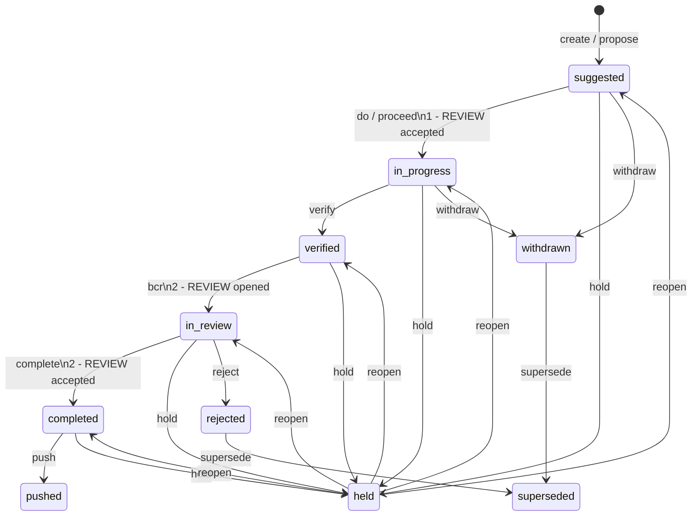

# Implementation Specification: Workspace Inventory & Configuration Management Engine

Module: docs/Implementation.md  
Purpose: Code-level catalog, data schemas, exported functions, tool parameters, and testing traceability for LCM_Inventory.  
Path: D:/Git_Repositories/LCM_Inventory/docs/Implementation.md  
Authors: Rolf, LCM_AI Engine  
Version: 10.0.0
Status: Authoritative Implementation  
Date: 2026-10-13

---

## 1. Directory Structure & File Taxonomy

```
LCM_Inventory/
├── .agents/
│   └── rules/                  # Canonical authoritative rule files (17 files)
├── data/
│   ├── artifacts/              # HTML presentation viewers (untracked)
│   ├── analysis/               # Retained machine-readable LCM analysis evidence
│   │   ├── definitions/        # Approved, operator-editable CON definitions
│   │   └── history/            # Immutable analysis runs
│   ├── inventory.json          # Live multi-repo configuration audit manifest
│   ├── proposals/
│   │   └── proposals.json      # Canonical proposal ledger (single source of truth)
│   ├── readiness/              # Quality gate test output files
│   ├── reviews/                # Cryptographic review receipts (untracked)
│   └── staging/                # Transient patch and diff staging
├── docs/
│   ├── Architecture.md         # End-user & topology architecture spec
│   ├── Requirements.md         # Normative technical & invariant requirements spec
│   ├── Implementation.md       # Code catalog, schemas & exported cmdlets spec
│   ├── Implementation of Security in LCM.md # Atomic elevation & privilege architecture
│   ├── INVENTORY_DASHBOARD.md  # Live audit markdown dashboard
│   ├── CHANGE_REQUEST_INDEX.md # Historical proposal reference table
│   ├── CM_POLICIES.md          # CM governance policy summary
│   └── Proposals/              # Junction link or directory for proposal plans
├── logs/
│   └── cm_activity.log         # Append-only multi-repo audit & push log
├── modules/
│   └── WorkspaceCM.psm1        # Core Configuration Management engine module
└── tools/                      # Deterministic CLI tools & UI dashboard launchers
```

---

## 2. Core Module Architecture (`WorkspaceCM.psm1`)

The central PowerShell module [`modules/WorkspaceCM.psm1`](file:///D:/Git_Repositories/LCM_Inventory/modules/WorkspaceCM.psm1) exports the foundational CM cmdlets:

| Exported Cmdlet | Purpose & Contract | Key Parameters |
|:---|:---|:---|
| **`Get-WorkspaceInventory`** | Reads and returns the parsed object model from `data/inventory.json`. | `-Path <string>` |
| **`Update-WorkspaceInventory`** | Scans all child directories under `D:\Git_Repositories`, evaluates Git dirty state and LCM versions, and updates `data/inventory.json` and `docs/INVENTORY_DASHBOARD.md`. | `-WorkspaceRoot <string>` |
| **`Test-WorkspaceDrift`** | Evaluates workspace state against LCM governance baselines and returns drift diagnostic objects. | `-WorkspaceRoot <string>` |
| **`Get-ProposalLedger`** | Parses and validates `data/proposals/proposals.json`. | `-Path <string>` |
| **`Save-ProposalLedger`** | Atomically serializes proposal updates back to `proposals.json` with UTF-8 encoding. | `-Ledger <PSCustomObject>` |
| **`New-Proposal`** | Creates and registers a new proposal in `suggested` state with next auto-incremented ID. | `-Title <string>`, `-Scope <string>`, `-Author <string>` |
| **`Set-ProposalState`** | Transitions a proposal through lifecycle states (`suggested`, `approved`, `completed`, `pushed`, `rejected`). | `-Id <int>`, `-State <string>`, `-Note <string>` |

---

## 3. Tool Scripts Inventory

All tools in `tools/` conform to `RULE-PS-008` (Headers), `RULE-PS-009` (Logging), and `RULE-PS-010` (CLI Help):

| Tool Script | Role & Function | Key Parameters |
|:---|:---|:---|
| **`Invoke-MacriumBcrReview.ps1`** | Visual review gate using the writable Macrium baseline and Beyond Compare 5 `_LCM` profile. | `-CRP <string>`, `-RepositoryName <string>`, `-BaseCommit <string>`, `-NoLaunch` |
| **`Invoke-WorkspacePush.ps1`** | Multi-repo lockstep Git push engine with Gemini export and proposal state transition. | `-Reason <string>`, `-Repositories <string[]>`, `-DryRun`, `-Help` |
| **`Invoke-WorkspaceAudit.ps1`** | CLI runner for multi-repo audit scan and drift assessment. | `-Help` |
| **`Test-LCMRuleHealth.ps1`** | Validates NTFS junction integrity and rule header parity across all repositories. | `-Fix`, `-Help` |
| **`Show-LcmControl.ps1`** | Canonical CM Control Hub renderer and launcher. The first functional release provides refresh, proposal/document viewing, log viewing, and Macrium BCR review launch. An ordinary launch never creates a background daemon session. | `-ReviewMode`, `-DatesMode`, `-Repo <string>`, `-State <string>`, `-Id <int>`, `-CliMode`, `-NoLaunch`, `-StartDaemon`, `-TimerOn` |
| **`Show-LcmActiveLauncher.ps1`** | LCM Tool Explorer displaying all 192 workspace tools with category filtering and execution routing. | `-Help` |
| **`Show-WorkspaceReadiness.ps1`** | Workspace readiness rollup viewer displaying test suite passing status and review receipts. | `-Help` |
| **`Invoke-Level1AnalysisRefinement.ps1`** | Generates the next immutable Level 1 evidence run from an approved `CON-001-L01` definition and retained baseline; an existing run is never overwritten. | `-DefinitionPath <string>`, `-OutputPath <string>`, `-RunId <string>`, `-Help` |
| **`Show-LcmAnalysisViewer.ps1`** | Renders the latest retained CON analysis evidence by default as an interactive, sortable, filterable LCM Analysis Viewer dashboard. | `-ReportPath <string>`, `-OutputPath <string>`, `-NoLaunch`, `-Help` |
| **`Complete-ToolDocumentation.ps1`** | Runs CRP-121’s data-first dependency passes: forward `WIUD` call evidence, then reverse `WUD` caller evidence. | `-Pass1`, `-Pass2`, `-All`, `-VerifyOnly`, `-Help` |
| **`Submit-ReviewResult.ps1`** | Programmatic acceptance hook recording review receipts into `data/reviews/`. | `-Repository <string>`, `-ReceiptPath <string>`, `-Help` |
| **`Test-ReviewCommitGate.ps1`** | Git pre-commit validator for the current Macrium BCR-approved baseline and staged diff. | `-RepositoryPath <string>` |

---

### 3.1 Control Hub Safe-Action Contract

`Show-LcmControl.ps1` renders `assets/CM_CONTROL_HUB_READONLY.html` with the current
proposal ledger, document cache, and activity logs. The template follows the
Implementation 0 prototype: a compact control surface, visible state rail, and a
complete change index. Its browser release is intentionally read-only except for
launching the existing Macrium BCR review tool:

- enabled: refresh, proposal/document inspection, activity-log viewing, and review launch;
- disabled: proposal state changes, cleanup, commits, and pushes;
- enforced: the browser's daemon command bridge accepts only
  `Invoke-MacriumBcrReview.ps1`.

This keeps the dashboard useful without providing a path to mutate
`data/proposals/proposals.json` or Git state.

The inspector also makes missing historical plan or walkthrough paths explicit; it
does not invent cached document content when an old ledger reference no longer exists.

### 3.2 Enforced Review Commit Gate

The root workspace and `LCM_Inventory` repositories use repository-local
`.githooks/pre-commit` hooks. A material commit from the command line or VS Code
Source Control is rejected unless `Submit-ReviewResult.ps1` has created a current
review authorization for the same repository, HEAD baseline, and staged diff.

The authorization expires after two hours and is removed immediately after the
commit succeeds. This makes an IDE commit attempt visible as a review-gate
failure instead of silently allowing an unreviewed change. The required sequence
is: launch BCompare, obtain operator acceptance, run
`Submit-ReviewResult.ps1`, then let that command create the commit and receipt.

### 3.3 IDE Canvas Read-Only Work Queue Projection

The project canvas extension at
`.github/extensions/lcm-control-hub/extension.mjs` serves the root-owned live
Control Hub page within the IDE and exposes a CRP-196 work-queue projection.
The projection separates visible lifecycle status from plan and progress state,
includes lifecycle counts, latest state-history evidence, milestone dates, and
repository-matched App catalog context. The `refresh-ledger` and `get-work-queue` canvas actions do not write proposal,
Git, or execution state. `prepare-review-decision` persists only a
non-mutating cohort-and-switches draft; it cannot accept a review, transition
lifecycle state, stage, commit, or publish.

---

## 4. Data Models & JSON Schemas

### Proposal Ledger Schema (`data/proposals/proposals.json`)
```json
{
  "$schema": "https://json-schema.org/draft/2020-12/schema",
  "version": "10.0.0",
  "updated_at": "2026-10-13 18:05:38",
  "proposals": [
    {
      "id": 156,
      "crp_id": "CRP-156",
      "timestamp": "2026-10-13 15:30:00",
      "title": "Standardize HTML Presentation Artifacts to data/artifacts/",
      "origin_repo": "LCM_Inventory",
      "state": "pushed",
      "progress_state": "pushed",
      "priority": "M",
      "author": "Rolf, LCM_AI",
      "details": "Relocate runtime HTML viewer generation to untracked data/artifacts/.",
      "plan_path": "LCM_Inventory/docs/Proposals/CRP-156-LCM-10.0.0-Standardize-HTML-Presentation-Artifacts-To-Data-Artifacts.md",
      "pushed_at": "2026-10-13 18:05:33"
    }
  ]
}
```

### 4.1 Recovery-Lifecycle Documentation Contract

The planned ledger/tool evolution uses `state` plus `state_reason` as one flat
current lifecycle record. Historical `state_history` data is append-only:
legacy entries remain byte-for-byte historical evidence, while future entries
may include `from_state`, `state_reason`, revision, cohort, semantic-delta,
review, and test-scope fields.

Active CRP/BUG bundles are temporary specifications. Push absorbs their
implemented delta into baseline tripartite documentation; reopening the same
work returns the same ID to `suggested` and appends a revision event. A semantic
specification change similarly restarts only affected IDs and drives
delta-only review/testing. A cohort coordination bundle records shared members,
dependencies, and aggregate verification without replacing individual records.

`ShowCM` is documented as both an overview and requested state-navigation
surface, with accept/reject and repository/cohort/complete forms. BCR remains
the main visual review surface. Review is not required for generated artifacts,
scratch content, data, logs, or routine test output; an unfiltered BCR peek and
helpful advisory are allowed. Managed lifecycle hooks remain applicable to
governed lifecycle transitions.

#### Lifecycle State, Gate, Action, and Switch Contract

`modules/ProposalManager.psm1` is the lifecycle authority. The Control Hub
projects its persisted state; it does not infer or change a transition. The
two review checkpoints deliberately use matching labels: **`1 - REVIEW`** is
the plan/activation decision and **`2 - REVIEW`** is the BCR/operator decision.

`Set-ProposalStore` also projects changed lifecycle states into the owning
bundle's `Specification.md` YAML header using `ProposalSpecificationState.psm1`.
Only `Status`, `Plan-State`, and `Progress-State` are replaced; the contract
body and unrelated metadata remain unchanged. Deferred batch transitions are
mirrored when the batch is persisted. New suggested bundles initialize their
own headers, and legacy records without bundles remain supported. Unchanged
states do not trigger historical-document reconciliation.

All affected headers are validated before writes. The ledger is staged beside
its destination and replaced only after specification writes succeed. A failed
write leaves the previous ledger intact and restores written specifications;
rollback errors are reported explicitly. This is failure recovery, not a
cross-file crash-atomic transaction.



| Persisted state | Hub label | External action(s) | Internal transition checks |
|---|---|---|---|
| `suggested` | `1 - REVIEW` | `do` / `proceed`, `hold`, `withdraw`, `supersede` | Gate 1 permits only an explicit transition to `in_progress`. |
| `in_progress` | In Progress | `verify`, `hold`, `reset`, `withdraw`, `supersede` | Verification evidence must exist before `verified`. |
| `verified` | Verified | `bcr`, `reopen`, `hold`, `supersede` | BCR resolves the exact CRP/COH and records the review identity. |
| `in_review` | `2 - REVIEW` | `complete`, `commit`, `reject`, `reopen`, `hold` | Completion requires a BCR disposition and no blocking `COH-<parent> — 1 - REVIEW (<repository>)` component. |
| `completed` | Completed | `push`, `hold`, `reinstate` | Commit/review gate evidence remains authoritative before publication. |
| `pushed` | Published | `view`, `reinstate` | Terminal publication state; no forward transition exists. |
| `held`, `withdrawn`, `rejected`, `superseded` | Held / terminal disposition | State-specific `reopen`, `view`, `withdraw`, or `supersede` | The transition matrix rejects every omitted edge. |

In the Work Queue, **Status** owns the review/disposition indicator and its
color: both Gate 1 and Gate 2 review work display **`REVIEW`** with the review
badge. **Plan State** identifies only the numbered lifecycle gate:
**`1 - REVIEW`** or **`2 - REVIEW`**. It must not repeat a BCR mechanism,
“pending” wording, or any review disposition.

An open cross-repository review is projected as a synthetic `COH-<parent-id>`
work item. It is presented as **`COH-<parent-id> — 1 - REVIEW
(<repository>)`** and has priority over its parent’s `2 - REVIEW`. A `do` or
`proceed` request for that parent redirects to the synthetic `COH` and opens
its required BCR; it never changes the parent state or accepts review evidence.
After the `COH` review is accepted, **Complete** returns to the parent.

If no lower-priority blocking `COH` exists, a `do`/`DOIT` request at
`2 - REVIEW` returns a decision report rather than regressing status: choose
**Complete** after BCR disposition is confirmed, or choose **Reopen** only for
further implementation. `DOIT` never selects either decision automatically.
For a selected CRP at `Verified`, `DOIT` routes `do` / `proceed` to the required
`bcr` action, opening `2 - REVIEW` without changing or accepting its disposition.

The following switches are **checks only**. They are intentionally absent from
the diagram because none changes a state by itself.

| Internal check/switch | Effect | Gate boundary |
|---|---|---|
| Workspace `flow_mode = doit` / `always_proceed = true` | Continues eligible planned work automatically. | May cross Gate 1; never accepts or bypasses Gate 2. |
| `MinimalTests` / testing mode | Selects the permitted validation depth and records that scope. | Does not waive verification, BCR, or disposition checks. |
| `Force` | Limits an authorized visual-review confirmation exception. | Does not waive lifecycle transitions, evidence, or unresolved-obligation checks. |
| `bcr_disposition` | Records the operator review result. | Required before `in_review → completed`, unless an authorized BCR bypass is recorded. |
| Cross-repository obligation ledger | Tracks review required in another repository. | Blocks `in_review → completed` until every obligation is completed. |

ShowCM renders all switches as individual colored **Workspace** buttons beside
**Work Queue**, never as lifecycle-menu actions. Governance, Testing, Review
Granularity, Analysis Mode, Flow (`DOIT`), and test depth are global settings;
neither a CRP nor a COH owns a switch.

#### Unresolved Design Questions

1. Confirm the exact persisted JSON names and required/optional metadata for
   future rich history events while preserving legacy records unchanged.
2. Define the authoritative baseline-document absorption receipt and retention
   location after push.
3. Define cohort coordination bundle schema, member ordering, and partial
   reopen behavior.
4. Define how `ShowCM` renders repository/cohort/complete forms when a request
   intentionally has no single CRP identity.
5. Reconcile the ledger's `last_proposal_id: 262` with the absence of a
   discoverable `BUG-262` bundle/material in the inspected proposal locations
   before implementing any BUG-262-specific behavior.

### 4.2 Cohort Control-Hub Contract (CRP-259)

The following is the implementation contract for the cohort controls; it does
not claim that the current read-only Hub has mutation capability. A cohort
record must persist an Item target of kind `COH`, `coh_id` in the form
`COH-<prime>`, exactly one `head_id`, zero or more additional `member_ids`, an
`open`/`closed` status, and append-only lifecycle, synchronization, BCR, and
member-disposition evidence. The corresponding CRP/BUG target uses kind
`CRP`; it must not be coerced into a COH.

Target resolution occurs before an action is enabled or dispatched. Row actions
operate on their own explicit Item target: CRP rows act on that CRP, and COH
rows act on that COH. No backend handler may use a repository, selection cache,
or active-cohort fallback. The sole convenience rule is unqualified
add-member: it resolves to the sole open COH only when exactly one exists.

The future mutation boundary must construct and validate a complete prospective
ledger change before writing it. It must reject duplicate or missing members,
an absent/non-member/non-unique head, an invalid status transition, ambiguous
target resolution, and a second open cohort. Opening a closed cohort performs
close-current/open-selected in one transaction. Failed validation, write, gate
sync, BCR launch, or disposition recording leaves no partial cohort, member,
or lifecycle update.

For a COH Gate 2 request, the dispatcher first evaluates every member's
required gate and evidence. It either records an all-member aligned/no-op
result or returns the specific failing member without launching BCR. Only an
aligned cohort can create one BCR session/receipt for the cohort, and that
receipt contains the exact COH target and a disposition for every member.
Result UI and the activity/audit record must show target resolution, member
dispositions, synchronization checks/result, BCR identity/disposition, and
refusal details. Gate 1 planning actions and Gate 2 BCR actions remain
separate; `DOIT` may automate flow to, but never through, the latter.

### Inventory Manifest Schema (`data/inventory.json`)
```json
{
  "$schema": "https://json-schema.org/draft/2020-12/schema",
  "title": "LCM Workspace Inventory",
  "generated_at": "2026-10-13 18:24:12",
  "workspace_ai_baseline": "10.0.0",
  "repositories": [
    {
      "RepositoryName": "LCM_Inventory",
      "Path": "D:\\Git_Repositories\\LCM_Inventory",
      "Classification": "governed",
      "GitStatus": "Git",
      "Branch": "main",
      "HeadCommit": "3d3c128",
      "DirtyState": "clean",
      "AheadBehind": "synced",
      "HasUnpushed": false,
      "LCMStatus": "governed",
      "AbsorbedLCMVersion": "10.0.0",
      "CurrentLCMVersion": "10.0.0",
      "ElevationRequired": false,
      "MinimumPrivilege": "User",
      "JunctionsHealthy": true
    }
  ]
}
```

<!-- FixDocumentation: CRP-196 Implementation -->
### 3.1 Documentation Reconciliation Tool

| Tool Script | Role & Function | Key Parameters |
|:---|:---|:---|
| **`Fix-Documentation.ps1`** | Reconciles explicit, repository-qualified CRP/BUG payloads into tripartite documents. | `<CRP/BUG scope>`, `-Apply`, `-OpenReview`, `-Trace` |
<!-- /FixDocumentation -->
