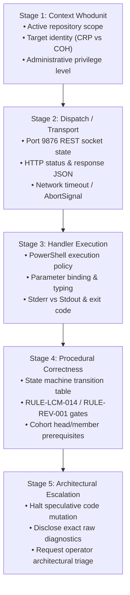

# Specification: CRP-218

```yaml
CRP-ID: CRP-218
Title: Diagnostic Triage Protocol for UI-to-Daemon Execution and Architecture Mismatch Escalation
Scope: LCM_AI
Baseline-Version: 10.1.0
Author: rgbig
Date: 2026-10-03 12:36:04
Status: Pushed
Plan-State: pushed
Progress-State: pushed
Priority: 8
App-ID: None
```

---

## 1. Executive Summary & Historical Origin

During forensic retrieval across Git history (commit `391c233`, 2026-10-03), the original definition and intent of **CRP-218** were recovered. 

Originally created during early REST daemon bridge (Port 9876) integration and UI action development, CRP-218 was scoped to **`LCM_AI`** to formalize a rigorous, standardized diagnostic protocol for AI agents encountering UI-to-daemon command execution failures or architectural discrepancies.

**Original Intent Recorded in Commit `391c233`**:
> *"Establish structured 5-stage diagnostics triage: context whodunit -> dispatch/transport -> handler execution -> procedural correctness -> operator clarification on architectural mismatches before attempting code modifications."*

Because zero implementation artifacts existed when it was initially registered, it was demoted to `held` as an *"unstarted Gate 1 proposal stub pending explicit design scheduling"*. It has now been accepted and implemented per operator direction (Option B).

---

## 2. Recovered 5-Stage Diagnostic Triage Architecture

The proposal envisions codifying a binding governance protocol into `.agents/rules/` preventing speculative trial-and-error debugging and enforcing systematic causal isolation:



### 2.1 Stage Breakdown
1. **Stage 1 — Context Whodunit**:
   - Determine active repository context, target item type (`CRP` vs `COH`), caller identity, and elevation status before analyzing code.
2. **Stage 2 — Dispatch & Transport**:
   - Verify Port 9876 daemon responsiveness, socket connectivity, HTTP error payloads, and abort signals before diagnosing script errors.
3. **Stage 3 — Handler Execution**:
   - Verify PowerShell process launch, argument passing, parameter validation sets, exit codes, and distinguish standard error (`stderr`) from business warnings.
4. **Stage 4 — Procedural & Lifecycle Correctness**:
   - Validate whether the attempted operation is legally admissible under current state machine rules (`Test-LcmProposalLifecycleTransition`, Gate 1/2 prerequisites).
5. **Stage 5 — Operator Clarification on Architectural Mismatches**:
   - If an error stems from an architectural mismatch, policy contradiction, or invalid lifecycle state, the agent `MUST NOT` attempt speculative code repairs or enter loop states. The agent `MUST` stop, surface the structured 5-stage diagnostic receipt to the operator, and request architectural clarification.

---

## 3. Operator Resolution & Implementation Record

- **Resolution**: Operator accepted **Option B** (2026-11-14).
- **Implementation**:
  - Codified `RULE-EFF-010: Diagnostic Triage Protocol & UI-to-Daemon Execution Mismatch Escalation Invariant` in `MethodEfficiencyPolicy.md`.
  - Codified `RULE-LCM-033: Diagnostic Triage Protocol & Architecture Mismatch Escalation Invariant` in `ProposalReviewFlowPolicy.md`.
  - Implemented persistent UI diagnostic `#errorModal` in `CM_CONTROL_HUB.html` and modal-open reload suppression in `lcm-display-freshness.js`.
- **Status**: Implemented and Completed.
