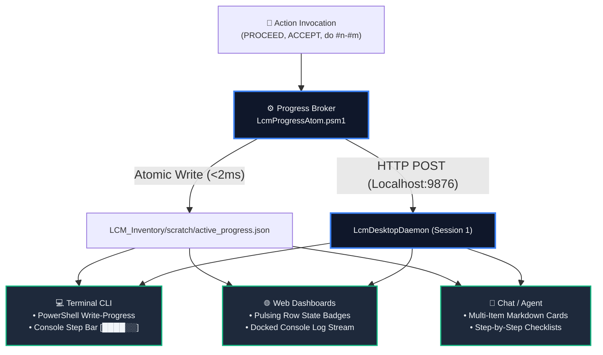

# Change Request Proposal: Universal Multi-Channel Progress Indicator Engine

- **Proposal ID**: `CRP-110`
- **Target Repository**: `LCM` (`Git_Repositories/LCM_Inventory/tools`, `LCM_Inventory`, `LCM_Shared`)
- **Target Version**: `10.0.0`
- **Domain**: `Lifecycle Model (LCM) Execution Telemetry & Cross-Channel Progress Architecture`
- **Author**: Rolf, LCM_AI Governance
- **Status**: `OPEN` (Awaiting Operator Review & PROCEED Trigger)
- **Created**: `2026-10-13 15:55:00`
- **Priority**: `HIGH`
- **Target Scope**: `LCM_Inventory/modules/LcmProgressAtom.psm1`, `LCM_Inventory/tools/Set-LcmActionProgress.ps1`, `LCM_Inventory/assets/lcm-table-engine.js`, `LCM_Inventory/docs/CM_CONTROL_HUB.html`, `LCM_Inventory/tools/Invoke-ProposalAction.ps1`, `RR.ps1`
- **Affected Version Range**: `10.0.0 - 10.0.0`
- **Impacted Repositories**: `Git_Repositories`, `LCM_Inventory`, `.lcm`, `All Governed Repositories`

---

## 1. Objective & Operational Rationale

This Change Request Proposal establishes the **Universal Multi-Channel Progress Indicator Engine** across the Lifecycle Model (LCM) ecosystem. When operators execute batch or single-item commands (such as `PROCEED <ID>`, `PROCEED ALL`, `ACCEPT <Repo>`, or `do #n-#m Proposals`), the system `MUST` broadcast granular, non-blocking, per-item progress indications across all three active interaction channels: **Chat UI**, **Terminal CLI**, and **Interactive Web Dashboards**.

### Current Deficits & Blind Waits
1. **Chat Blind Execution**: In conversation turns where multiple proposals or repositories are processed, the operator sees no intermediate progress until the entire multi-item batch completes or halts.
2. **Terminal Invisibility**: Batch commands executed in PowerShell (e.g. `Invoke-ProposalAction.ps1 -Do -Batch "106-108"`) often output monolithic logs without high-level percentage or parent/child progress visualization.
3. **Web Dashboard Disconnect**: In `CM_CONTROL_HUB.html` or `Show-Tools`, clicking an action button dispatches an asynchronous background task, leaving table rows static until a manual refresh or full page reload occurs.

---

## 2. Hybrid Tri-Channel Architecture

The Hybrid Progress Engine couples lightweight file-backed state with REST broadcast, ensuring zero external service dependencies while providing real-time UI updates:



---

## 3. Channel Presentation Specifications

### 3.1 Channel A: Terminal CLI Presentation
1. **Native PowerShell `Write-Progress`**:
   - **Parent Activity**: Overall batch summary (e.g., `Processing PROCEED Batch (2 of 4)`).
   - **Child Activity**: Current operational phase of the active item (e.g., `Running Pester Quality Gates`).
   - **Percent Complete**: Calculated dynamically across items and sub-phases.
2. **Console Step Bar**:
   - Renders clean, high-density monospace step indicators:
     ```text
     [1/3] #106 Tool Consolidation  : [████████████████████] 100% (Completed)
     [2/3] #107 Prio Column Engine  : [██████████░░░░░░░░░░]  50% (Quality Gates...)
     [3/3] #108 Table Display Std   : [░░░░░░░░░░░░░░░░░░░░]   0% (Queued)
     ```

### 3.2 Channel B: Interactive Web Dashboard Presentation (`CM_CONTROL_HUB.html`)
1. **Dynamic Row Mutation**:
   - When an item transitions to `in_progress`, its table row immediately receives an animated visual pulse (`class="row-processing"`).
   - The status badge changes to an active spinner: `<span class="badge badge-amber badge-pulse">⚙️ 45% Verification</span>`.
2. **Docked Console Telemetry Stream**:
   - Each phase transition streams a timestamped, color-coded entry into the bottom interactive CM Console via `appendConsole()`.
3. **Dual Polling / Push Broker**:
   - Web clients listen to Port 9876 events, with automatic fallback to polling `LCM_Inventory/scratch/active_progress.json` every 750ms if the daemon is detached.

### 3.3 Channel C: Chat / Agent Response Card
- In chat turns, the AI agent emits structured Markdown progress cards during multi-item operations:
  ```markdown
  ### 🚀 Action Execution: PROCEED 106-108
  - [x] **#106**: `CRP-106` • ✅ **Completed** (Quality Gates passed, review recorded)
  - [>] **#107**: `CRP-107` • ⚙️ **In-Progress** (Running Pester AST syntax verification...)
  - [ ] **#108**: `CRP-108` • ⏳ **Queued** (Awaiting completion of #107)
  ```

---

## 4. Universal Data Contract: `active_progress.json`

The ephemeral progress file is maintained in `LCM_Inventory/scratch/active_progress.json` and conforms to the schema:

```json
{
  "$schema": "https://json-schema.org/draft/2020-12/schema",
  "action_id": "ACT-2026-0907-154500",
  "command": "PROCEED",
  "origin_channel": "Chat",
  "created_at": "2026-10-13 15:45:00",
  "updated_at": "2026-10-13 15:45:08",
  "total_items": 3,
  "completed_items": 1,
  "overall_percent": 45,
  "status": "in_progress",
  "items": [
    {
      "id": "106",
      "cr_id": "CRP-106",
      "label": "Tool Architecture Consolidation",
      "target_repo": "LCM / Tooling",
      "state": "completed",
      "phase": "Completed",
      "percent": 100,
      "started_at": "2026-10-13 15:45:00",
      "completed_at": "2026-10-13 15:45:05",
      "error": null
    },
    {
      "id": "107",
      "cr_id": "CRP-107",
      "label": "CM Control Hub Prio Column Engine",
      "target_repo": "LCM_Inventory",
      "state": "in_progress",
      "phase": "Pester Quality Gate",
      "percent": 50,
      "started_at": "2026-10-13 15:45:05",
      "completed_at": null,
      "error": null
    },
    {
      "id": "108",
      "cr_id": "CRP-108",
      "label": "Universal Table Standard Display",
      "target_repo": "LCM / Assets",
      "state": "queued",
      "phase": "Waiting in queue",
      "percent": 0,
      "started_at": null,
      "completed_at": null,
      "error": null
    }
  ]
}
```

---

## 5. Technical Delivery & Component Breakdown

1. **`LcmProgressAtom.psm1`**:
   - Core atomic module providing:
     - `Start-LcmProgressBatch -Command <str> -ItemIds <array> [-Origin <str>]`
     - `Update-LcmProgressItem -Id <str> -Phase <str> -Percent <int> [-State <str>]`
     - `Complete-LcmProgressItem -Id <str> [-Error <str>]`
     - `Stop-LcmProgressBatch`
2. **REST Daemon Endpoints (Port 9876)**:
   - Adds `/progress/start`, `/progress/update`, `/progress/complete`, and `/progress/current` to `LcmDaemonCore.psm1`.
3. **Dashboard Consumer (`lcm-table-engine.js`)**:
   - `LcmProgressWatcher`: Background interval reading `/progress/current` or `active_progress.json`, applying CSS animations to matching table row IDs.
4. **Runner Instrumentations**:
   - Instruments `Invoke-ProposalAction.ps1`, `RR.ps1`, and `Submit-ReviewResult.ps1` to call `LcmProgressAtom` at each stage.

---

## 6. Verification & Quality Gates

1. **Terminal Test**: Run `Invoke-ProposalAction.ps1` with mock items; assert `Write-Progress` renders parent/child bars without flicker.
2. **Web Test**: Open `CM_CONTROL_HUB.html`; trigger a multi-item batch; verify that row status badges transition through `queued` $\rightarrow$ `in_progress` $\rightarrow$ `completed` in real-time.
3. **Resilience Test**: Terminate `LcmDesktopDaemon.ps1`; verify that file-based polling (`active_progress.json`) seamlessly maintains dashboard row progress without error dialogs.


