# Change Request Proposal: CRP-121
# Automated Bidirectional Tool Dependency Documentation Engine (WIUD & WUD)

| Metadata Field | Value |
| :--- | :--- |
| **Proposal ID** | `CRP-121` |
| **Lifecycle State** | `IN_PROGRESS` (`DOIT`; reopened 2026-10-05 after ledger/specification reconciliation) |
| **Origin Repository** | `LCM` / Tooling & Documentation Governance |
| **Target Scope** | Tool Documentation Engine (`.lcm/tools/internal/Update-ToolDependencies.ps1`), Storage (`docs/tools/<ToolName>/`), Governance Policies (`.agents/rules/DocumentationStandardsPolicy.md`, `ProposalReviewFlowPolicy.md`) |
| **Author** | Rolf, LCM_AI |
| **Date** | 2026-09-08 |
| **Version Impact** | `v7.3.0` |
| **Related Proposals** | `CRP-117` (Single Authoritative Tool Catalog), `CRP-119` (Monotonic Naming Scheme), `BUG-120` |

---

## 1. Executive Summary & Problem Statement

Across the LCM solution ecosystem (140+ tools in `.lcm/tools/internal`, `.lcm/Cmd/`, `LCM_Inventory/tools/`, etc.):
1. **Constituent Blindness**: Individual tools lack a deterministic inventory of external constituents they call directly (external executables, imported modules, referenced sub-scripts, and Port 9876 desktop daemon endpoints).
2. **Reverse Impact Ignorance**: Developers and automated agents modifying or deprecating a tool cannot easily determine *what uses it directly* (which `.cmd` trampolines, which parent scripts, or which HTML dashboards dispatch it).
3. **Documentation Drift**: While tripartite specifications (`Architecture.md`, `Requirements.md`, `Implementation.md`) exist at the repository level (`RULE-DOC-001`), individual tool capabilities and interface contracts drift out of sync with real code implementations.
4. **Git Churn Hazard**: Un-gated bulk documentation generation across 140+ files touches timestamps and generates false Git diffs on files whose dependencies never actually changed.

---

## 2. Architecture & Operational Model

### 2.0 Implemented Data-First Delivery

The first delivery implements the two graph data passes before producing
per-tool Markdown projections:

1. `Complete-ToolDocumentation.ps1 -Pass1` creates
   `data/dependencies/forward-index.json` with `WIUD` call evidence.
2. `Complete-ToolDocumentation.ps1 -Pass2` reads only forward evidence and
   creates `data/dependencies/reverse-index.json` with `WUD` callers.

Static calls are classified as production, test, temporary, generated, or
unknown. Only uniquely resolved production edges participate in reverse impact
and candidate-dead-code results; dynamic, external, and duplicate-name targets
remain explicit unresolved evidence. Per-tool Markdown files are deferred until
the operator accepts the graph data.

### 2.1 The Two Core Artifacts per Tool
Each tool `ToolName.ps1` maintains its dependency documentation in a dedicated directory:
`docs/tools/<ToolName>/`:

1. **`ToolName-WIUD.md` ("What It Uses Directly" — Forward Constituents)**:
   - **PowerShell Modules**: Modules imported via `Import-Module`, `using module`, or `#Requires -Modules` with resolved path and semantic version.
   - **Sub-Tools & Scripts**: Direct script invocations (`& <path>`, `pwsh -File <path>`, `Start-Process`).
   - **External Binaries**: Executables invoked (`git.exe`, `BCompare.exe`, `notepad++.exe`, `es.exe`, Windows built-ins like `bcdedit.exe`, `fltmc.exe`) with detected file/product versions.
   - **Port 9876 REST Actions & Indirect Targets**:
     - Scans for REST dispatch calls (`Invoke-RestMethod` to `http://127.0.0.1:9876/...`).
     - Statically inspects the JSON payload (e.g. `command: "notepad++ <file>"`, `filePath: "<doc>"`) to resolve and document the **secondary application or script targeted through the desktop daemon bridge**.

2. **`ToolName-WUD.md` ("What Uses Directly" — Reverse Callers)**:
   - **Command Trampolines**: All `.cmd` files in `.lcm/Cmd/` targeting this tool.
   - **Caller Scripts & Modules**: Other `.ps1` / `.psm1` / `.py` files invoking this tool.
   - **Interactive Dashboards**: Buttons, action menus, and anchor links in HTML viewers (`SHOW_TOOLS.html`, `CM_CONTROL_HUB.html`, `SHOW_RULES.html`, `WORKSPACE_INVENTORY_VIEWER.html`).
   - **Daemon Action Controllers & Tasks**: Scheduled tasks, daemon controller methods, or Git hooks referencing this tool.

---

### 2.2 Two-Pass Phased Execution Model

To balance immediate accuracy with workspace performance:

```mermaid
flowchart TD
    subgraph CommitTime["Local Commit Phase (Per-Tool)"]
        C1["Tool Modified & Reaching COMMITTED"] --> C2["Run Pass 1: Complete-ToolDocumentation -Tool <Name> -Pass1"]
        C2 --> C3["Compute SHA-256 Hash of Script"]
        C3 --> C4{"Hash Changed?"}
        C4 -->|No| C5["Short-Circuit (<1ms Skip)"]
        C4 -->|Yes| C6["AST Extract Outgoing Constituents + Port 9876 Targets"]
        C6 --> C7["Generate docs/tools/<ToolName>/<ToolName>-WIUD.md"]
        C7 --> C8["Include in Commit Payload (RULE-LCM-005)"]
    end

    subgraph PrePushTime["Remote Push Phase (Workspace-Wide)"]
        P1["Invoke-WorkspacePush Triggered"] --> P2["Run Pass 2: Complete-ToolDocumentation -Pass2"]
        P2 --> P3["Build In-Memory Solution Dependency Index"]
        P3 --> P4["Invert Graph (G -> G^T) to Map All Callers"]
        P4 --> P5["Generate / Refresh docs/tools/<ToolName>/<ToolName>-WUD.md"]
        P5 --> P6["Sync with Gemini Knowledge Base (RULE-LCM-013) & Push"]
    end

```



1. **Pass 1 (`-Pass1` / Commit Time)**:
   - Evaluates **only** the specific tool being committed.
   - Sub-second runtime (~50ms).
   - Generates or updates `<ToolName>-WIUD.md`.
2. **Pass 2 (`-Pass2` / Pre-Push Time)**:
   - Whole-solution reverse index compiler.
   - Runs before `Invoke-WorkspacePush.ps1` (alongside `Update-Gemini.ps1`).
   - Inverts the call graph to update all `<ToolName>-WUD.md` files.

---

### 2.3 Hash-Gating Cache Engine (`.dependency_cache.json`)
To prevent unnecessary file writes, modified timestamp churn, and dirty Git working trees:
- The engine computes a `SHA-256` content hash of each target script.
- Records state in `docs/tools/.dependency_cache.json`:
  ```json
  {
    "Show-Rules.ps1": {
      "source_hash": "e3b0c44298fc1c149afbf4c8996fb92427ae41e4649b934ca495991b7852b855",
      "last_scanned": "2026-09-08 15:25:00",
      "last_crp": "BUG-120",
      "wiud_file": "docs/tools/Show-Rules/Show-Rules-WIUD.md",
      "wud_file": "docs/tools/Show-Rules/Show-Rules-WUD.md"
    }
  }
  ```
- If the source script's hash has not changed, Pass 1 skips execution in `<1ms`.

---

## 3. CLI Command Specification: `Complete-ToolDocumentation.ps1`

```powershell
Complete-ToolDocumentation [[-Tool] <string>] [-Pass1] [-Pass2] [-All] [-Force] [-VerifyOnly] [-Help]
```

- **`-Tool <Name>`**: Scopes analysis to a specific tool.
- **`-Pass1`**: Runs forward constituent analysis (`WIUD.md`) only.
- **`-Pass2`**: Runs reverse caller graph compilation (`WUD.md`) workspace-wide.
- **`-All`**: Full two-pass rebuild.
- **`-Force`**: Bypasses the hash gate cache and forces regeneration.
- **`-VerifyOnly`**: Dry-run mode that asserts all tools have up-to-date dependency specs (fails quality gate if stale).

---

## 4. Policy Alignment (`RULE-DOC-007`)

Codify in [`.agents/rules/DocumentationStandardsPolicy.md`](file:///D:/Git_Repositories/.agents/rules/DocumentationStandardsPolicy.md):
- **`RULE-DOC-007: Mandatory Automated Tool Constituent & Caller Documentation Invariant`**:
  - Every permanent tool in `.lcm/tools/internal/` and governed repositories must maintain up-to-date `WIUD.md` and `WUD.md` records.
  - `Pass 1` is mandatory during `COMMITTED` review gating.
  - `Pass 2` is mandatory during `Invoke-WorkspacePush.ps1`.

---

> [!NOTE]
> **Registered in OPEN State**:
> Per `RULE-LCM-015` and `RULE-LCM-016`, this proposal is registered in the CM ledger in the `OPEN` state awaiting explicit `PROCEED 121` authorization before implementation planning and execution commence.
