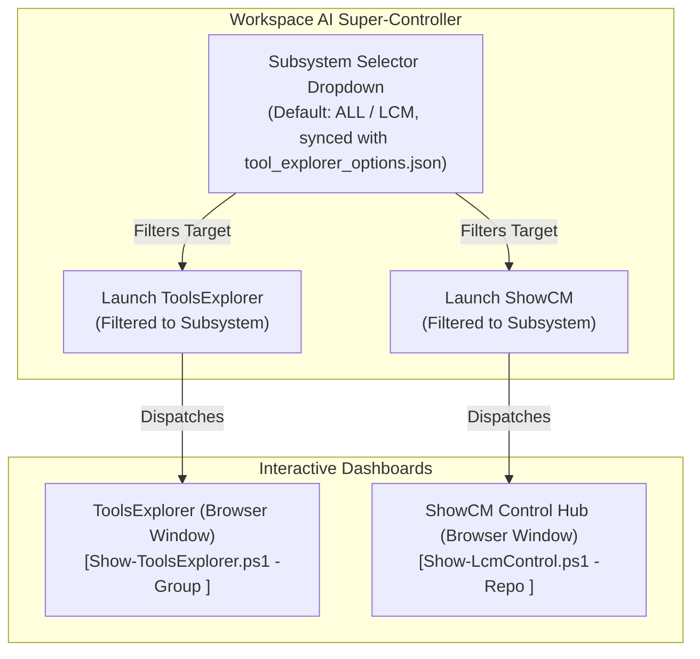

# Change Request Proposal: CRP-176

```yaml
CRP-ID: CRP-176
Title: Workspace AI Super-Controller for Unified Subsystem Navigation (ToolsExplorer & ShowCM)
Scope: LCM_AI, .lcm, LCM_Inventory, IDE Answer Box & Companion Interface
Baseline-Version: 10.0.0
Author: Rolf, Antigravity AI Assistant
Date: 2026-10-13
Status: Suggested
Plan-State: suggested
Progress-State: undecided
Priority: Medium
Impacted-Repositories:
  - LCM_AI
  - LCM_Inventory
  - Git_Repositories
```

---

## 1. Executive Summary & Intent

This proposal defines the architecture and implementation for the **Workspace AI Super-Controller**—a unified, lightweight navigation hub directly accessible from within the IDE interface (the agent answer pane or companion panel) and terminal.

Rather than treating tool launching as disconnected actions or relying on complex background discovery, the Super-Controller provides a clear, high-level tripartite control interface:

1. **Subsystem Selector**:
   - An authoritative dropdown menu listing all workspace subsystems (e.g. `LCM`, `LCM_Inventory`, `LCM_AI`, `HaSSD06`, `SystemConfiguration`, `LCM_Supervision`, and `All`).
   - Defaults to the active context or `LCM` / `All`.
   - Selecting a subsystem updates the target context for all child tools and views.

2. **ToolsExplorer Launcher**:
   - Opens or activates the modern [ToolsExplorer](file:///LCM_Inventory/tools/Show-ToolsExplorer.ps1) pre-filtered to the chosen Subsystem.

3. **ShowCM Launcher**:
   - Opens or activates the CM Control Hub ([ShowCM](file:///LCM_Inventory/tools/Show-LcmControl.ps1)) pre-filtered to proposals, lifecycle states, and reviews for the chosen Subsystem.

---

## 2. Core Functional Requirements

### 2.1 Subsystem Selection Engine
- The Super-Controller dropdown draws directly from the precompiled taxonomy in [`LCM_Inventory/config/tool_explorer_options.json`](file:///LCM_Inventory/config/tool_explorer_options.json).
- Selection changes immediately propagate to the connected launchers:
  - Passing `-Group <Subsystem>` to `Show-ToolsExplorer.ps1`.
  - Passing `-Repo <Subsystem>` to `Show-LcmControl.ps1` (`ShowCM`).
- Remembers last selected Subsystem across IDE restarts via local configuration.

### 2.2 Direct Integration Modes
The Super-Controller will support three flexible operational presentations:

1. **IDE Chat / Answer Box View (Primary)**:
   - When the operator prompts for status, tools, or control, the assistant renders the Super-Controller directly into the response pane as an interactive HTML/Markdown action widget with live clickable links and launcher buttons.
2. **Desktop Companion / Sidecar View**:
   - An integrated header bar in the companion viewer (`LCM_SIDECAR.html`) providing the Subsystem dropdown and one-click dispatch to ToolsExplorer and ShowCM.
3. **CLI Dispatcher (`SuperController.cmd` / `Show-SuperController.ps1`)**:
   - Fast terminal command to launch both viewers scoped to the specified Subsystem in a single command.

---

## 3. Architecture & Interaction Diagram



---

## 4. Feasibility Analysis & Alternative Architectural Options

### Option A: Interactive IDE Answer Box Widget (Native Markdown + Action Links)
- **Feasibility**: High.
- **Mechanism**: The agent outputs an HTML/Markdown card with a `<select>` or button group using custom URI handlers (`lcm://open?tool=ToolsExplorer&subsystem=LCM` and `lcm://open?tool=ShowCM&subsystem=LCM`) or pre-built clickable dispatch links.
- **Pros**: Zero installation overhead; appears directly in the conversation stream without opening extra windows.
- **Cons**: Standard Markdown within some chat renderers does not execute dynamic JavaScript `<select>` event handlers natively unless wrapped in a webview.

### Option B: Dedicated Companion Panel / Webview (Sidecar Expansion)
- **Feasibility**: Very High.
- **Mechanism**: Integrate the Super-Controller controls into the top of the already existing `LCM_SIDECAR.html` or an Antigravity IDE webview extension.
- **Pros**: Full JavaScript support, persistent broadcast channel communication, native dropdowns, zero renderer limitations.
- **Cons**: Operates in a browser or side panel window alongside the IDE.

### Option C: Standalone Lightweight Desktop Toolbar (WPF / Native Webview)
- **Feasibility**: Medium.
- **Mechanism**: A tiny, always-on-top 40px taskbar or floating strip with the Subsystem dropdown and the two buttons.
- **Pros**: Independent of browser and IDE tabs.
- **Cons**: Requires additional process management and UI framework.

---

## 5. Implementation Decision: Option A (IDE Answer Box Action Widget)

Per operator directive on 2026-10-13, **Option A** has been selected and implemented as the authoritative design. Alternatives B and C imply keeping an extra browser window open, whereas the operator interface is centered within the IDE and uses Zen Browser (`D:\Tools\Zen Browser\zen.exe`) when external dashboards are required.

### 5.1 Artifacts Implemented
1. **Interactive Answer Box Widget**:
   - Structured markdown card with Subsystem scope badges and one-click dispatch links.
2. **Unified Navigation Dispatcher (`Show-SuperController.ps1`)**:
   - Dispatches `Show-ToolsExplorer.ps1 -Group <Subsystem>` and/or `Show-LcmControl.ps1 -Repo <Subsystem>`.
3. **Canonical Trampoline (`SuperController.cmd`)**:
   - Fast CLI entry in `LCM_Inventory/Cmd/SuperController.cmd`.
4. **Browser Isolation**:
   - Enforces Zen Browser (`D:\Tools\Zen Browser\zen.exe`) with `--new-window` dispatch to prevent window collisions.

