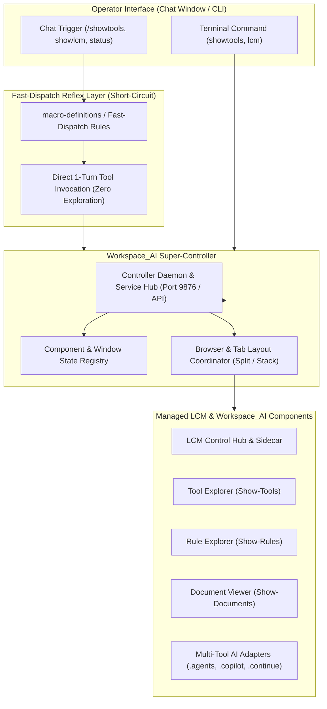

# Change Request Proposal: CRP-176

```yaml
CRP-ID: CRP-176
Title: Workspace AI Super-Controller and Fast-Dispatch Reflexes for Component Orchestration
Scope: Workspace_AI, .lcm, Workspace_Inventory, .agents, Interactive Shell & Chat Window
Baseline-Version: v7.6.0
Author: Rolf, Antigravity AI Assistant
Date: 2026-09-26
Status: Suggested
Plan-State: suggested
Progress-State: suggested
Priority: Medium
Impacted-Repositories:
  - Workspace_AI
  - Workspace_Inventory
  - Git_Repositories
```

---

## 1. Executive Summary & Context

As the LCM ecosystem grows, interaction with its core tools and viewers is increasingly driven directly from the IDE chat window (e.g. issuing `/showtools`, `showrules`, `showlcm`, or checking system status). However, two related operational bottlenecks have emerged:

1. **Chat Window Latency & Exploratory Wandering ("The Reflex Problem")**:
   - When an operator requests an action like `/showtools` or asks to open an LCM viewer in chat, the AI agent often initiates an extensive exploratory loop—running file searches, reading script definitions, analyzing parameter bindings, and reasoning through multiple tool steps before executing the launcher.
   - For routine, well-known operational commands, this exploratory research is redundant overhead. Operators need an immediate, zero-latency "short-circuit" reflex that fires the intended tool directly in turn 1.

2. **Absence of a Unified "Super-Controller" for Workspace_AI**:
   - The primary components of Workspace_AI and LCM—including the `Show-*` family (`Show-LcmControl.ps1`, `Show-LcmSidecar.ps1`, `Show-Tools.ps1`, `Show-Rules.ps1`, `Show-Actions.ps1`, `Show-Documents.ps1`), the Desktop Daemon (`LcmDesktopDaemon.ps1`), background monitors, and multi-tool adapters—currently operate as autonomous, loosely-coupled scripts.
   - There is no central orchestrator or "super-controller" that maintains unified lifecycle awareness, window/tab layouts, service health, inter-component communication, and standardized dispatch targets across both the desktop environment and the AI agent interfaces.

> [!NOTE]
> **Preliminary Status**: This proposal is intentionally preliminary. It outlines the core architectural concept, requirements, and design options for discussion and refinement prior to detailed technical analysis and implementation planning.

---

## 2. Core Operational Challenges

### 2.1 The Agent Latency Dilemma (Chat vs. CLI)
When an operator is in the PowerShell terminal, launching `showtools` is instantaneous. In contrast, in the AI chat interface:
- The agent treats the prompt as an open-ended research problem unless constrained by high-precedence policy.
- The agent inspects `Cwd`, checks tool paths, reads script headers, tests parameter validation, or considers alternative execution strategies.
- This creates 10–30 seconds of perceived lag and consumes unnecessary context tokens for what should be an instantaneous reflex.

### 2.2 Fragmented Component Execution & State
- **Decentralized Dispatch**: Each `Show-*` tool independently discovers the user's default browser, negotiates desktop elevation, talks to `LcmDesktopDaemon` over port 9876, and manages its own window focus.
- **No Consolidated Lifecycle**: When multiple dashboards are launched, there is no single supervisor tracking which dashboards are alive, which ports or channels are active, or ensuring optimal multi-tab / split-view layouts across different browser types.
- **Agent Barrier**: An AI agent wanting to interact with or trigger workspace components lacks a clean, consolidated API or controller interface.

---

## 3. Architectural Vision: The Super-Controller & Reflex System



---

## 4. Key Design Pillars

### 4.1 Pillar I: Fast-Dispatch Agent Reflexes
- **Reflex Rules**: Formalize a high-precedence "Fast-Dispatch Reflex Table" in the agent's governing rules (e.g. `.agents/rules/macro-definitions.md` or a dedicated reflex policy).
- **Exact Match Triggers**: When patterns like `/showtools`, `showtools`, `/showrules`, `showlcm`, or `/status` are received:
  - The agent is forbidden from running exploratory discovery tools (`list_dir`, `grep_search`, `view_file` on scripts).
  - The agent immediately issues the known execution command via `run_command` in its very first tool turn.
- **Slash-Command Integration**: Align IDE slash commands directly with controller dispatch routes.

### 4.2 Pillar II: The Workspace_AI Super-Controller
- **Unified Entry Point**: A centralized controller module (e.g., `Start-WorkspaceAiController.ps1` or an evolved `LcmDesktopDaemon`) that acts as the single orchestrator for:
  - Starting, stopping, and restarting dashboards.
  - Querying live component health, open ports, and active viewer PIDs.
  - Ensuring single-instance execution and tab deduplication across Zen, Firefox, Edge, and Chrome.
- **REST / IPC Interface**: Provide a lightweight local API endpoint (e.g., `http://127.0.0.1:9876/controller/launch?component=tools`) allowing both shell scripts, the AI agent, and browser viewers to trigger actions seamlessly.
- **Super-Controller UI / Tray / CLI**: Optional minimal status dashboard or tray indicator providing one-click access to all workspace components.

---

## 5. Preliminary Invariants & Requirements

1. **Zero-Research Reflex Invariant**:
   - Invocations matching registered fast-dispatch triggers must result in execution in Turn 1 without prior file searches or exploratory reads.
2. **Deterministic Browser Handling**:
   - The Super-Controller must inherit and enforce the dynamic default browser detection established in CRP-164/CRP-175, respecting user browser preferences (Zen/Firefox single-window multi-tab split, Edge/Chrome stacked windows).
3. **Non-Disruptive Multi-Tab Orchestration**:
   - Launching a child component (e.g., `showtools`) must never close, overwrite, or navigate away from an active Hub or Sidecar session.
4. **Resilience & Graceful Fallback**:
   - If the Super-Controller daemon is not running when a fast-dispatch command is issued, the reflex route must gracefully launch it on-demand or fall back to direct script execution.

---

## 6. Open Exploration Questions for Discussion

1. **Daemon Evolution vs. New Component**:
   - Should the existing `LcmDesktopDaemon.ps1` be expanded into the Super-Controller, or should the Super-Controller sit above the desktop daemon as a higher-level orchestrator?
2. **Reflex Rule Location**:
   - Should fast-dispatch shortcuts be governed purely via `.agents/rules/macro-definitions.md`, or should they also be registered in `.agents/skills/` or IDE-specific settings?
3. **Interactive Scope**:
   - Which specific components should be initially managed by the Super-Controller? (Candidates: `Show-LcmControl`, `Show-LcmSidecar`, `Show-Tools`, `Show-Rules`, `Show-Documents`, `Sync-GeminiProfile`, `Test-LCMRuleHealth`).
