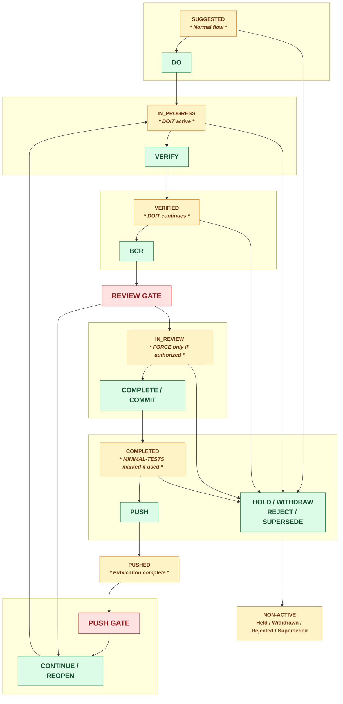

# CRP-261: Proposal Lifecycle Status and Action Model

| Metadata Field | Value |
|---|---|
| Proposal ID | `CRP-261` |
| Lifecycle State | `IN_PROGRESS` |
| Target Scope | Proposal ledger, Control Hub, lifecycle commands, review, commit, and push governance |
| Impacted Repositories | `LCM_Inventory`, `LCM_AI` |
| Priority | `9` |

## Deficit

Proposal lifecycle values currently overlap across `state`, `progress_state`, and `disposition`.
Some ledger entries have no usable bundle, and operator-facing displays can show proposals without
a valid action. Completion can also infer repository scope instead of proving exact CRP identity.

## Required Outcome

Implement one authoritative internal lifecycle state, explicit external display status, auditable
transition actions, exact-CRP review/commit/push identity, and atomic proposal creation.

## Transition Compatibility

During migration, the legacy `progress_state` and `disposition` fields remain readable compatibility
data only. New or modified tooling must derive lifecycle behavior exclusively from the authoritative
`state` field and the transition matrix in this specification. Older documentation may retain terms
such as `approved`, `processed`, `deferred`, `committed`, and `published` until its scheduled
reconciliation; those terms must not create additional transitions or action availability.

The formal proposal lifecycle state in the metadata table is intentionally not advanced by
implementation work alone. It will be reconciled with the ledger and review evidence immediately
before the final Gate 2 review.

## Operator Switches

| Switch | Scope | Effect | Boundary |
|---|---|---|---|
| `DOIT` | Proposal | Sets `flow_mode=doit` and `always_proceed=true`. | Never bypasses BCR, completion, push, or terminal-state rules. |
| `-MinimalTests` | Completion/review cycle | Records minimal test scope for the cycle. | Does not waive exact CRP identity or the final review gate. |
| `-Force` | Authorized review exception | Waives only interactive visual-review confirmation when explicitly authorized. | Must not waive syntax, quality, readiness, exact-CRP, or push-preflight checks. |
| `-Immediately` | Explicit cohort | Defers quality checks during an operator-documented emergency recovery caused by a severity condition, deadlock, loop, race condition, or inability to self-remedy. | Requires `-Details`; it is not `-Force`. A single non-BUG target is reclassified as `BUG-<id>` with its original CRP identity retained in audit metadata. A multi-proposal cohort must already contain a `BUG-<id>`. The deferral is recorded across the cohort with its triggering BUG ID and ends at the BCR/Gate 2 handoff. |
| `coarse` / `tight` | Workspace | Selects combined or per-proposal review granularity. | Does not alter transition validity. |
| `LCM mode` | Workspace | Enables or pauses lifecycle governance controls. | Does not erase proposal records or bypass mandatory final review when active. |
| `Testing mode` | Workspace | Enables or pauses deep testing cascades. | Syntax and focused validation remain required. |
| `ADMINMODE` | Tool design criterion | Records whether a tool was designed to require elevation. Setting it off during redesign marks elevation as no longer required. | Does not remove existing elevation code by itself; the redesign must remove obsolete elevation behavior and validate the result. |

## Lifecycle Diagram

| Visual convention | Meaning |
|---|---|
| <strong>Red</strong> | Review or validation gate |
| <strong>Green bold</strong> | Operator action |
| <strong>Yellow</strong> | Internal authoritative status |

## Review Gate Definitions

| Gate | Entry action | Pass condition | Return/failure path |
|---|---|---|---|
| Review Gate | `BCR`, then `COMPLETE` / `COMMIT <CRP>` | Exact CRP, baseline, scope receipt, operator acceptance, and final scope check pass. | Return to `IN_PROGRESS` or `NON-ACTIVE`; no commit is created. |
| Push Gate | `PUSH <CRP>` or computed cohort push | Cohort eligibility, remote state, receipts, and conflict preflight pass. | Return to `COMPLETED` or `NON-ACTIVE`; no push occurs. |

## Status and Action Mapping

| Status | External Control Hub status | Operator actions |
|---|---|---|
| `SUGGESTED` | Suggested | Edit, Do, Hold, Withdraw, Supersede |
| `IN_PROGRESS` | In Progress | Edit, Verify, Hold, Reset, Withdraw, Supersede |
| `VERIFIED` | Verified | BCR, Reopen, Hold, Supersede |
| `IN_REVIEW` | Review Pending | Complete, Commit, Reject, Reopen, Hold |
| `COMPLETED` | Committed / Ready to Push | Push, Hold |
| `PUSHED` | Pushed | View only |
| `HELD` | Held | Continue, Edit, Withdraw |
| `WITHDRAWN` | Withdrawn | View, Supersede |
| `REJECTED` | Rejected | View, Supersede, Create linked BUG |
| `SUPERSEDED` | Superseded | View linked replacement |

## Color-Coded Operator Actions

| Internal status | <strong>External status</strong> | <strong>Available actions</strong> |
|---|---|---|
| <strong>SUGGESTED</strong> | Suggested | <strong>EDIT, DO, HOLD, WITHDRAW, SUPERSEDE</strong> |
| <strong>IN_PROGRESS</strong> | In Progress | <strong>EDIT, VERIFY, HOLD, RESET, WITHDRAW, SUPERSEDE</strong> |
| <strong>VERIFIED</strong> | Verified | <strong>BCR, REOPEN, HOLD, SUPERSEDE</strong> |
| <strong>IN_REVIEW</strong> | Review Pending | <strong>COMPLETE, COMMIT, REJECT, REOPEN, HOLD</strong> |
| <strong>COMPLETED</strong> | Committed / Ready to Push | <strong>PUSH, HOLD</strong> |
| <strong>PUSHED</strong> | Pushed | <strong>VIEW</strong> |
| <strong>HELD</strong> | Held | <strong>CONTINUE, EDIT, WITHDRAW</strong> |
| <strong>WITHDRAWN</strong> | Withdrawn | <strong>VIEW, SUPERSEDE</strong> |
| <strong>REJECTED</strong> | Rejected | <strong>VIEW, SUPERSEDE, CREATE LINKED BUG</strong> |
| <strong>SUPERSEDED</strong> | Superseded | <strong>VIEW LINKED REPLACEMENT</strong> |
