# Change Request Proposal: CRP-309 (Master Proposal)

```yaml
CRP-ID: CRP-309
Title: Unified Elevated Desktop Daemon, Universal Back Channel, Security Gateway, and Standard Interface Object Architecture
Scope: LCM_Inventory and governed display repositories
Baseline-Version: 10.2.1
Author: rgbig
Date: 2026-11-08 16:52:00
Status: Pushed
Plan-State: pushed
Progress-State: pushed
Priority: High
App-ID: APP-001
Supersedes: CRP-292, CRP-293, CRP-294, CRP-295, CRP-296, CRP-297, CRP-248, BUG-289
```

---

## 1. Executive Summary & Intent

Consolidate desktop daemon orchestration, administrative elevation, and presentation layer delivery into a single, unified, high-performance architecture centered on **Port 9876** running with `-RunLevel Highest` under the active user account.

This Master Proposal resolves systemic usability, security, and architectural deficiencies across all LCM interactive interfaces by:
1. Moving all business and lifecycle logic out of HTML frontends into backend domain atoms (Thin-Client Architecture).
2. Providing a universal synchronous back channel (`stdout`, `stderr`, `exitCode`) for all commands.
3. Introducing an interactive, in-browser Execution Feedback Drawer to eliminate blind waits.
4. Enforcing binding CORS headers and permissive CSP for reliable Antigravity IDE pane hosting (`ShowTools -Pane`).
5. Securing privileged operations with a single-use JIT Ephemeral Token under the Quad-Principal `Authenticated Users` standard.
6. Eliminating ghost windows in `Invoke-InteractiveDesktop.ps1`.
7. Eliminating optimistic UI desynchronization in the Control Hub (`BUG-289`).
8. Establishing a **Tiered Security Authorization Gateway** on Port 9876 with caller provenance auditing, role-based capability boundaries, and structured audit logging (`security_gateway.log`).
9. Introducing the **Universal Command Gateway (`lcm do <target>`)** powered by a standardized **Interface Object (Action Intent DTO)** to eliminate brittle switch parsing and deprecate 144 `.cmd` launcher trampolines.

---

## 2. Operational & Usability Gap Analysis

The following vertical matrix maps each operational defect to its architectural resolution:

```mermaid
flowchart TD
    P1["❌ Problem 1: Silent Black Hole of Elevation<br/><i>Start-Process -Verb RunAs blocks stdout/stderr capture</i>"]
    R1["✅ Resolution 1: Pre-Authorized Elevated Daemon<br/><i>Runs with RunLevel Highest; synchronous stream redirection</i>"]
    
    P2["❌ Problem 2: Brittle Frontend Command Construction<br/><i>HTML builds raw PowerShell strings; silent syntax/path failures</i>"]
    R2["✅ Resolution 2: Thin-Client Typed Intents<br/><i>Frontend submits typed JSON (POST /api/action); backend atoms execute</i>"]
    
    P3["❌ Problem 3: Blind Waiting & Missing In-Browser Output<br/><i>Action clicks show only a spinner; operator must check disk logs</i>"]
    R3["✅ Resolution 3: Collapsible Execution Feedback Drawer<br/><i>Styled terminal drawer displaying live stdout, stderr, and exit codes</i>"]
    
    P4["❌ Problem 4: IDE Webview & Pane Hosting Blocks<br/><i>Missing CORS & rigid CSP block vscode-webview:// requests</i>"]
    R4["✅ Resolution 4: Binding CORS & Permissive Webview CSP<br/><i>Access-Control-Allow-Origin: *; ShowTools -Pane works in IDE tabs</i>"]
    
    P5["❌ Problem 5: Ghost Windows from Background Subshells<br/><i>SessionId != 0 check spawns unfocused/hidden windows</i>"]
    R5["✅ Resolution 5: Dispatcher Remediation<br/><i>Remove premature check; prioritize REST daemon AppActivate dispatch</i>"]
    
    P6["❌ Problem 6: Optimistic UI Desynchronization (BUG-289)<br/><i>Governance toggle recolors on click without backend confirmation</i>"]
    R6["✅ Resolution 6: Authoritative State Synchronization<br/><i>UI binds strictly to confirmed /displays/data/hub state</i>"]

    P1 --> R1 --> P2 --> R2 --> P3 --> R3 --> P4 --> R4 --> P5 --> R5 --> P6 --> R6
```



### Detailed Problem & Resolution Breakdown

#### Problem 1: The "Silent Black Hole" of Elevated Execution
* **The Defect:** When an administrative tool was triggered, the standard daemon executed `Start-Process pwsh.exe ... -Verb RunAs`. Due to Windows security boundaries across elevation contexts, standard streams (`stdout` and `stderr`) cannot be redirected to an un-elevated caller. The caller received no execution feedback, could not determine exit codes, and was blind to runtime errors unless output was hand-piped to temporary disk files.
* **The Resolution:** The unified desktop daemon runs pre-authorized with `-RunLevel Highest` under the user's account. Because it already possesses elevated privileges, it launches target processes directly with standard stream redirection (`RedirectStandardOutput = $true`, `RedirectStandardError = $true`), returning full terminal streams, execution duration, and integer exit codes directly in the HTTP JSON response payload.

#### Problem 2: Brittle Frontend Command-String Construction
* **The Defect:** Browser interfaces (`CM_CONTROL_HUB.html`, `lcm-tool-explorer.js`) constructed raw, complex PowerShell command-line strings (e.g. `pwsh -NoProfile -ExecutionPolicy Bypass -File ... -Param1 ...`) and posted them to `/execute`. Any typo, quoting mismatch, path variance, or parameter change in the script caused silent failures or syntax errors, while business logic and lifecycle rules were unnecessarily duplicated in client-side JavaScript.
* **The Resolution:** Shift completely to the Thin-Client Presentation Architecture (mandated in `CRP-266`, `CRP-292`, and `CRP-293`). The frontend constructs zero PowerShell strings. It submits typed, semantic JSON intents (e.g. `POST /api/tools/run`, `POST /api/proposal/action`). The backend PowerShell domain atoms own parameter validation, path resolution, lifecycle feasibility checks, and execution.

#### Problem 3: Blind Waiting & Missing In-Browser Output
* **The Defect:** Clicking a tool or action in Tool Explorer or Control Hub displayed only a generic spinning indicator. If a script took 30 seconds or failed with a terminating error, the operator had zero in-browser terminal feedback and had to manually hunt down log files on disk (`LCM_Inventory/data/logs/...`) to figure out what occurred.
* **The Resolution:** Introduce a collapsible **Execution Feedback Drawer** directly into the Standard Display UI. As soon as the command completes, the drawer displays execution duration, an exit status badge (🟢 Exit 0 / 🔴 Exit 1), and a styled terminal panel containing the exact `stdout` and `stderr`. If a script fails, the drawer automatically expands to highlight the error immediately.

#### Problem 4: IDE Webview & Pane Hosting Blocks
* **The Defect:** Attempting to host displays inside the Antigravity IDE editor or side pane (e.g. `ShowTools -Pane`) failed or hung. The daemon omitted standard CORS headers (`Access-Control-Allow-Origin: *`, `Access-Control-Allow-Private-Network: true`), and set a restrictive Content-Security-Policy (`connect-src 'self'`). Because an IDE webview runs under `vscode-webview://`, browser security blocked all REST API and status calls, while client-side scripts (`lcm-display-freshness.js`) threw fatal errors if the host wasn't literally `http://127.0.0.1:9876`.
* **The Resolution:** Enforce binding CORS headers across all Standard Displays and static assets in `LcmDisplayHttp.psm1`. Update the CSP to `frame-ancestors 'self' vscode-webview:; connect-src 'self' http://127.0.0.1:* vscode-webview:;` and update `lcm-display-freshness.js` to recognize and permit webview container environments.

#### Problem 5: Ghost Windows from Background Subshells
* **The Defect:** In `Invoke-InteractiveDesktop.ps1`, lines 184–194 contained an early check: if `$currentSessionId -ne 0`, it executed `Start-Process` locally and returned immediately. When AI agent subshells or background runners executed this, they ran under Session 1, triggering the check and bypassing the daemon. On Windows, `Start-Process` from a background runner does not surface or focus windows on the physical desktop, creating invisible "ghost" processes that left the operator wondering why nothing opened.
* **The Resolution:** Remove the premature `$currentSessionId -ne 0` short-circuit in `Invoke-InteractiveDesktop.ps1`. Establish Route A (REST daemon dispatch via `http://127.0.0.1:9876/open` and `/execute`) as the primary path, utilizing the daemon's active desktop window manager (`AppActivate`) with robust try/catch fallback to Route B (Task Scheduler).

#### Problem 6: Optimistic UI Desynchronization (BUG-289)
* **The Defect:** The Control Hub governance toggle optimistically recolored itself to `ON` upon being clicked, even if the backend proposal ledger had `lcm_mode: paused` or if the daemon rejected the state transition. This gave the operator a false perception of active governance.
* **The Resolution:** Bind UI controls strictly to backend-confirmed data returned by `/displays/data/hub`. Requests display a concise pending state without recoloring, and update only upon verified backend receipt. If a transition fails, the last confirmed state is retained and a descriptive error banner is rendered.

#### Problem 7: Trampoline Proliferation and Maintenance Fragility
* **The Defect:** LCM currently maintains over 140 individual `.cmd` trampolines in `LCM_Inventory/Cmd/` (and proposals contemplated duplicating trampolines across child repositories). Each trampoline executes `cmd.exe` $\rightarrow$ `pwsh.exe`, imposing a 2-stage startup latency penalty, brittle path resolution across multi-boot drives, and massive synchronization churn whenever tools are added, renamed, or retired.
* **The Resolution:** Deprecate individual tool trampolines in favor of a single universal command dispatcher (`lcm.cmd` on PATH) communicating directly with the elevated Port 9876 daemon (`lcm do <target>`). The daemon eliminates the shell startup cascade, executes tools directly, and provides centralized lifecycle management.

#### Problem 8: Unchecked Outside Tool Invocations and Heterogeneous Parameter Passing
* **The Defect:** External callers (scripts, AI agents, command prompts, IDE tasks) invoke tools using arbitrary, heterogeneous CLI flags (`-Flag`, `/flag`, `--flag`, positional parameters). This causes frequent syntax errors, escaping pitfalls, missing context (who called what), and completely lacks caller authorization checks before dangerous privileged mutations run.
* **The Resolution:** Standardize on a structured **Interface Object (Action Intent DTO)** for all tool and action invocations (`{ action: "DO", target: "...", caller: "...", context: {...}, parameters: {...}, options: {...} }`). Establish an authorization gateway on Port 9876 that inspects caller provenance, verifies capabilities against a 3-tier security matrix, logs an audit trail to `security_gateway.log`, and unpacks parameters deterministically.

---

## 3. Gate 0 Contract

### Target State
1. A single Windows Scheduled Task (`LCM_DesktopDaemon`) runs `LcmDesktopDaemon.ps1` at user logon with `-RunLevel Highest` on `127.0.0.1:9876`.
2. All HTTP responses from Port 9876 (both REST endpoints and Standard Display routes) consistently return standard CORS headers (`Access-Control-Allow-Origin: *`, `Access-Control-Allow-Private-Network: true`).
3. Calling `ShowTools -Pane` or opening Standard Displays in an IDE webview / Simple Browser pane functions interactively without CORS or Content-Security-Policy connection errors.
4. `POST http://127.0.0.1:9876/execute` supports `{ "command": "...", "elevated": true, "sync": true }` and returns synchronous `stdout`, `stderr`, and `exitCode` across the HTTP socket without triggering interactive Windows UAC prompts.
5. All interactive UI displays (`CM_CONTROL_HUB.html`, `lcm-tool-explorer.js`) dispatch typed JSON intents (`POST /api/action`) rather than constructing raw PowerShell command strings.
6. Displays provide an interactive, collapsible output drawer rendering real-time command execution results, duration, and error diagnostics.
7. Privileged command execution requires a valid, single-use, 30-second TTL ephemeral token bound to the command hash.
8. Token and cache directories conform to the Quad-Principal `Authenticated Users:(OI)(CI)F` multi-boot standard.
9. A universal entrypoint `lcm.cmd` is deployed on system PATH, routing CLI calls (`lcm do <target> [flags/json]`) through the Port 9876 execution gateway.
10. Outside tool callers communicate via a standardized Interface Object (Action Intent DTO) ensuring typed parameters, caller attribution, and execution consistency across CLI, UI, and AI agents.
11. The Port 9876 Security Gateway enforces a 3-tier capability authorization model (Tier 1 Public/Observer, Tier 2 Operator/Action, Tier 3 Admin/Privileged Mutation).
12. Centralized audit logging in `LCM_Inventory/data/logs/security_gateway.log` records timestamp, caller provenance, target intent, parameter hash, authorization status, duration, and exit code for every invocation.

### Invariants and Exit Criteria
* **RULE-ELEV-005 Compliance**: Spawning interactive elevated consoles continues to enforce `-NoExit` / `/k` so operator output remains visible.
* **RULE-DSP-008 Compliance**: Displays remain container-agnostic, supporting both external browser windows and IDE pane embedding seamlessly.
* **CRP-305 Compliance**: The browser communicates exclusively via `http://127.0.0.1:9876`; no secondary ports or local-file fallbacks.
* **Zero UAC Interruption**: Automated and background agent tool executions route through the pre-authorized elevated daemon without blocking on manual UAC confirmation dialogs.
* **Authoritative Gateway Invariant (Zero Secondary Fallbacks)**: Per operator decision, fragile secondary fallback routes (Route B Task Scheduler launcher, Route C direct UAC RunAs, and individual `.cmd` trampolines) are explicitly retired. The Port 9876 daemon is the single authoritative execution gateway. If the daemon is unreachable, the CLI (`lcm do`) attempts automated self-healing via `Start-ScheduledTask LCM_DesktopDaemon`; otherwise it yields a deterministic error rather than spawning ghost windows or interactive UAC prompts.

### Explicit Non-Goals
* No external or remote network binding: the daemon remains strictly bound to `127.0.0.1` (loopback).
* No multi-port daemon fragmentation: no secondary daemon on Port 9877.
* No secondary execution fallbacks: direct UAC RunAs and secondary Task Scheduler launcher tasks are retired.
* No changes to underlying tool execution semantics or core repository business logic.

---

## 4. Technical Requirements & Invariants

### Clause 1: Single Elevated Daemon Task Architecture
* Reconfigure `Register-LcmDesktopDaemon.ps1` to register `LCM_DesktopDaemon` with:
  * `Principal`: `$env:USERNAME`
  * `RunLevel`: `Highest`
  * `LogonType`: `Interactive`
* Because the daemon runs with administrative privileges in Session 1 under the user's account, it inherits the user's exact environment, drive mappings, Git configuration, and user virtualenv while possessing full administrative capability.

### Clause 2: Universal Back Channel for Privileged and Standard Tasks
* Update `DaemonActionController.ps1` (`ExecuteCommand`):
  * When `req.Sync` is `$true`, execute via synchronous process redirection (`RedirectStandardOutput = $true`, `RedirectStandardError = $true`), capturing complete streams, execution duration, and exit code.
  * When `req.Sync` is `$false` and `req.Elevated` is `$true` with `req.NoExit`, dispatch a visible elevated console to Session 1 per `RULE-ELEV-005`.
  * Return structured JSON response:
    ```json
    {
      "status": "COMPLETED",
      "exitCode": 0,
      "stdout": "...",
      "stderr": "...",
      "durationMs": 45,
      "elevated": true
    }
    ```

### Clause 3: Thin-Client Architecture & Typed Controller Routes (CRP-266 / CRP-292 / CRP-293)
* Eliminate client-side command string construction from `CM_CONTROL_HUB.html` and `lcm-tool-explorer.js`.
* Establish typed REST controller routes on the daemon:
  * `POST /api/tools/run` $\rightarrow$ `{ "tool": "RestoreSettings", "args": "-DryRun" }`
  * `POST /api/proposal/action` $\rightarrow$ `{ "crpId": "CRP-308", "action": "verify" }`
  * `POST /api/governance/mode` $\rightarrow$ `{ "mode": "normal" | "paused" }`
* Backend domain atoms (`ProposalManager.psm1`, `LcmToolCatalog.psm1`) evaluate lifecycle eligibility, resolve paths, and validate parameters before execution.

### Clause 4: Rich Live Execution Feedback Drawer in UI
* Standard Display clients (`CM_CONTROL_HUB.html`, `lcm-tool-explorer.js`) incorporate a unified, collapsible **Execution Feedback Drawer**:
  * Displays active spinner during execution.
  * On completion, reveals a styled terminal panel containing the exact `stdout`, `stderr`, execution duration, and exit code badge (🟢 Exit 0 / 🔴 Exit 1).
  * Automatically expands on failure so the operator never experiences silent errors.

### Clause 5: Binding CORS & CSP Alignment for IDE Pane Hosting (`ShowTools -Pane`)
* In `modules/LcmDisplayHttp.psm1`, update `Send-LcmDisplayResponse` to emit:
  * `Access-Control-Allow-Origin: *`
  * `Access-Control-Allow-Methods: GET, POST, OPTIONS`
  * `Access-Control-Allow-Headers: Content-Type, Access-Control-Allow-Private-Network`
  * `Access-Control-Allow-Private-Network: true`
* Update Content-Security-Policy to allow frame ancestry and connection from IDE webview containers:
  `frame-ancestors 'self' vscode-webview:; connect-src 'self' http://127.0.0.1:* vscode-webview:;`
* Update `assets/lcm-display-freshness.js` to permit execution within IDE pane environments while verifying Port 9876 delivery.
* Add `-Pane` parameter to `Show-ToolsExplorer.ps1` and `Show-LcmControl.ps1` to launch directly inside the Antigravity IDE editor/side pane.

### Clause 6: JIT Ephemeral Token Security Gate
* Implement `LcmTokenVault.psm1`:
  * JIT generation of 32-byte cryptographic nonce.
  * Command signature: `HMAC-SHA256(Nonce, Command)`.
  * TTL: 30 seconds.
  * Single-use burn on verification.
  * Token store directory: `LCM_Inventory/data/tokens/` governed by Quad-Principal ACL (`Authenticated Users:(OI)(CI)F`, `SYSTEM:F`, `Administrators:F`).

### Clause 7: Dispatcher Remediation (`Invoke-InteractiveDesktop.ps1`)
* Remove the premature short-circuit on `$currentSessionId -ne 0` that prevented routing to Port 9876.
* Enforce Route A (Port 9876 REST `/open` and `/execute`) as the primary path, wrapped in robust try/catch with fallback to Route B (Task Scheduler).

### Clause 8: Control Hub Governance Toggle Remediation (BUG-289)
* Update `CM_CONTROL_HUB.html` and daemon status endpoint to reflect authoritative backend governance state (`lcm_mode` from `proposals.json`).
* Ensure toggle reflects real state and provides explicit visual feedback (`Gov: On` / `Gov: Off`) without optimistic misreporting.

### Clause 9: Universal Command Gateway (`lcm do`) & Standard Interface Object
* Provide a single universal command entrypoint `LCM_Inventory/Cmd/lcm.cmd` (and `Invoke-LcmAction.ps1`) positioned on system PATH:
  * Syntax: `lcm do <target> [parameters...]`
  * Example: `lcm do RestoreSettings -DryRun` or `lcm do --input <json-file-or-string>`
* All tool invocations serialize into the standardized **Interface Object (Action Intent DTO)**:
  ```json
  {
    "$schema": "http://127.0.0.1:9876/schemas/action-intent.json",
    "action": "DO",
    "target": "RestoreSettings",
    "caller": "AntigravityAgent | Console | Script | UI",
    "context": {
      "repo": "LCM_Inventory",
      "workingDirectory": "d:\\Git_Repositories"
    },
    "parameters": {
      "DryRun": true,
      "Component": "Logitech"
    },
    "options": {
      "sync": true,
      "elevated": true,
      "timeoutSeconds": 120
    }
  }
  ```
* The CLI client (`lcm`) serializes user switches into this DTO, transmits it via `POST http://127.0.0.1:9876/api/action`, receives synchronous stream execution results, and writes `stdout`/`stderr` back to the operator's console with exit code fidelity.
* This convention deprecates the maintenance burden of 140+ individual `.cmd` trampolines.

### Clause 10: Central Security Authorization Gateway & Audit Trail
* The Port 9876 daemon acts as the centralized Security Authorization Gateway.
* **Three-Tier Capability Authorization Model**:
  * **Tier 1: Public / Observer** (Read-Only): Catalog inspection, health checks, telemetry, display asset delivery (`GET /displays/*`, `GET /api/catalog`). No token required.
  * **Tier 2: Operator / Action** (Standard Execution): Code formatting, unit tests, inventory audits, document generation (`POST /api/action` for unprivileged tools). Allowed for authenticated local user session.
  * **Tier 3: Admin / Privileged Mutation** (High-Risk Execution): System settings restoration, Macrium baseline mounting, BCD boot configuration, proposal governance pause, system service modifications. Requires a valid, non-expired JIT ephemeral token (`Clause 6`) generated under the Quad-Principal standard.
* **Central Audit Trail**:
  * Every incoming request to `/api/*` is validated and logged to `LCM_Inventory/data/logs/security_gateway.log` with fields:
    `{ timestamp, caller, target, tier, authorized: true/false, parametersHash, durationMs, exitCode }`.
  * Unauthorized or malformed intent attempts return HTTP 403 Forbidden with structured error diagnostics.

---

## 5. Proposal Absorption & Supersession Matrix

By consolidating transport, elevation, thin-client interfaces, and UI feedback into `CRP-309`, the following 8 fragmented proposals are formally absorbed and marked **SUPERSEDED**:

| Proposal ID | Original Title | Superseded By | Reason for Consolidation |
| :--- | :--- | :--- | :--- |
| **`CRP-292`** | Standard Display Atom and Adoption Programme | **`CRP-309`** | Absorbed as Master Architecture contract. |
| **`CRP-293`** | ShowCM Typed Controller Reference Completion | **`CRP-309`** | Absorbed in Clause 3 (Typed REST routes). |
| **`CRP-294`** | Read-Only Standard Display Shell Migration | **`CRP-309`** | Absorbed in Clause 5 (CORS & Display delivery). |
| **`CRP-295`** | Interactive Table Standard Display Migration | **`CRP-309`** | Absorbed in Clauses 3 & 4 (Thin client & Feedback drawer). |
| **`CRP-296`** | Native Standard Display Dialog & Launcher Parity | **`CRP-309`** | Absorbed in Clause 7 (`Invoke-InteractiveDesktop.ps1` fix). |
| **`CRP-297`** | Console and Launcher Standard Display Parity | **`CRP-309`** | Absorbed in Clause 2 (Universal back channel). |
| **`CRP-248`** | Standard Display Tri-State Filter & Search Atom | **`CRP-309`** | Absorbed into standard display asset baseline. |
| **`BUG-289`** | Control Hub Governance Switch State Reflection | **`CRP-309`** | Absorbed in Clause 8 (Governance toggle remediation). |
