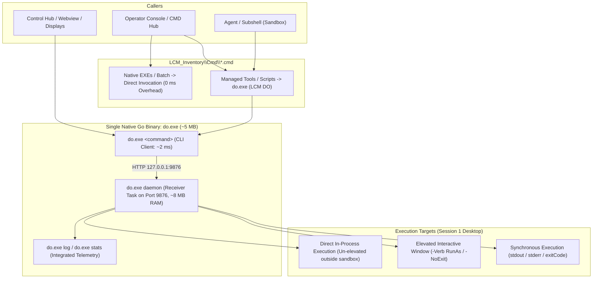

# CRP-320: Unified Tool Gateway & Simplified Execution Architecture (LCM DO)

```yaml
CRP-ID: CRP-320
Title: CRP-320: Unified Tool Gateway and Simplified Execution Architecture
Scope: LCM_Inventory, LCM_Tools
Baseline-Version: 10.2.4
Author: Rolf, Antigravity
Date: 2026-11-11
Status: Completed
Plan-State: completed
Progress-State: completed
Priority: Medium
App-ID: 1
```

Module: docs/Proposals/CRP-320-CRP-320-Unified-Tool-Gateway-and-Simplified-Execut/Specification.md  
Purpose: Architectural specification for unifying all workspace tool invocations, eliminating fragmented dispatchers (Invoke-PrivilegedTool, Invoke-InteractiveDesktop), direct-binding native executables in trampolines, and establishing centralized telemetry and execution metrics under LCM DO.  
Path: docs/Proposals/CRP-320-CRP-320-Unified-Tool-Gateway-and-Simplified-Execut/Specification.md  
Authors: Rolf, Antigravity  
Version: 1.1.0  
Status: Authoritative Specification (Gate 1 Accepted)  
Date: 2026-11-11  

---

## 1. Executive Summary & Problem Statement

### 1.1 The Problem: Fragmentation & Overhead
Over successive lifecycle updates, the invocation of tools across the LCM workspace has fragmented into multiple competing, fragile mechanisms:
1. **The Obnoxious Elevation Interceptor (`Invoke-PrivilegedTool.ps1`)**:
   Generated trampolines in `LCM_Inventory/Cmd/` inject boilerplate `net session` probes that spawn `Invoke-PrivilegedTool.ps1`, which in turn attempts to parse arguments, probe the daemon, or fall back to scheduled tasks.
2. **The GUI Bridge (`Invoke-InteractiveDesktop.ps1`)**:
   Another distinct dispatching script used when tools want to open an HTML dashboard or browser on Session 1.
3. **The Unnecessary PowerShell Wrapper Antipattern**:
   Native Windows executables (such as `FolderTimeUpdate.exe`) were needlessly wrapped in intermediate PowerShell scripts (`FolderTimeUpdate.ps1`), introducing 400–800ms of CLR startup latency, argument escaping corruption, and uncommanded `-NoExit` terminal windows.
4. **The Sandbox / UIPI Mismatch**:
   Agents running in non-elevated sandbox subshells cannot send window messages (`WM_COPYDATA`) directly to elevated desktop processes (e.g. `es.exe` failing with `Error 8`), triggering catastrophic uncommanded disk crawls (`Get-ChildItem -Recurse`).
5. **The Heavy Background PowerShell Daemon**:
   The scheduled task `LCM_DesktopDaemon_rgbig` runs a hidden `pwsh.exe` process consuming 100+ MB of RAM with potential `HttpListener` thread starvation.

---

## 2. Target Architectural Model: "LCM DO" (Single Go Binary Architecture)



---

## 3. Core Requirements & Invariants

### Requirement 1: Native Go Implementation (`do.exe`)
- Implemented as a single, compiled, static binary under `LCM_Inventory/Cmd/do.exe` conforming to `GoRules.md` (`LCM-RULE-GO-001`).
- Supports dual operational modes:
  - **Client Mode (`do <command>`)**: Parses flags (`-sync`, `-elevated`, `-noexit`), dispatches HTTP request to port 9876, and returns formatted console output in **< 3 milliseconds**.
  - **Daemon Mode (`do daemon`)**: Runs as the lightweight background receiver task on Port 9876, consuming < 10 MB RAM and replacing `LcmDesktopDaemon.ps1` in the `LCM_DesktopDaemon_rgbig` scheduled task.

### Requirement 2: Direct Trampoline Execution for Native Executables
- `Update-ToolCatalog.ps1` inspects tool type:
  - If `Type == "Executable"`: Trampoline calls the binary directly (`"%targetRef%" %*`).
  - If `Type == "Batch"`: Trampoline calls `call "%targetRef%" %*`.
  - Zero PowerShell startup latency (< 5 ms vs 800 ms).

### Requirement 3: Retirement of `Invoke-PrivilegedTool.ps1`
- `Invoke-PrivilegedTool.ps1` is permanently retired.
- Any trampoline requiring elevation invokes:
  ```cmd
  net session >nul 2>&1
  if %errorlevel% neq 0 (
    do.exe -command "%~nx0 %*" -elevated -noexit
    exit /b
  )
  ```

### Requirement 4: Integrated Logging & Telemetry (`do log` / `do stats`)
- Every execution envelope is automatically recorded in `LCM_Inventory/data/logs/do/last_do.json`.
- Failed executions generate `LCM_Inventory/data/logs/do/last_error.log`.
- Operator command **`do log`** instantly displays stdout, stderr, exit code, and duration of the last run.
- Operator command **`do stats`** displays live tool execution counts, timing averages, and failure metrics.

### Requirement 5: Zero Unbounded Disk Crawl Fallbacks
- Under no circumstances may `Search-Everything.ps1` or any tool fall back to recursive filesystem crawls (`Get-ChildItem -Recurse`). Tools must fail fast with single-line diagnostics in 0 ms if services are unreachable.
