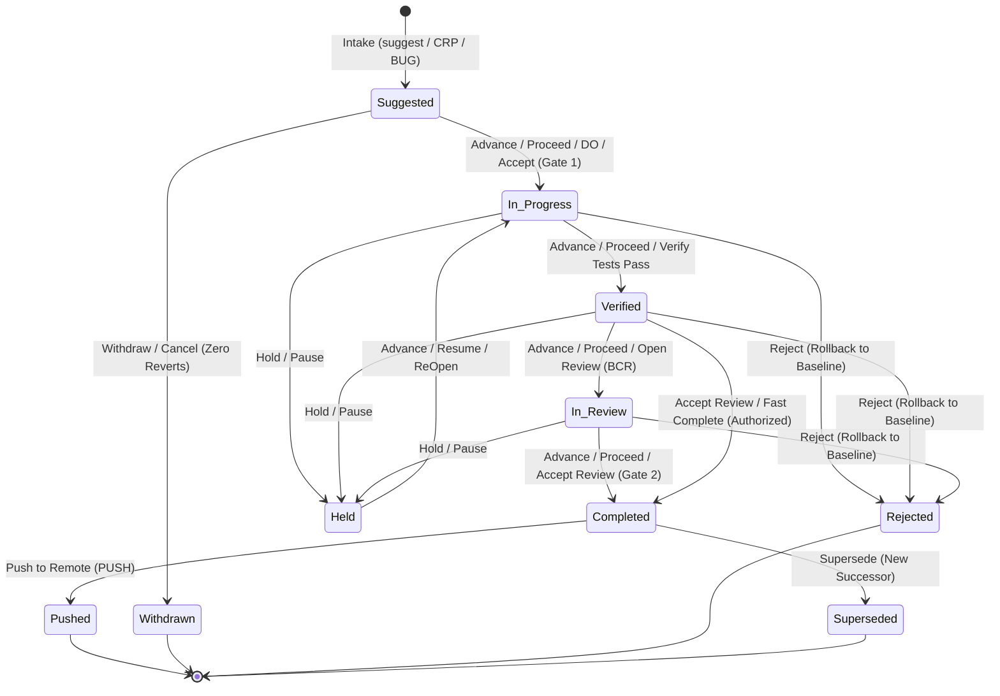

# Specification: Proposal Lifecycle Advance and Accept Harmonization, Switch Telemetry, and Daemon Action Alignment

```yaml
CRP-ID: CRP-329
Title: Proposal Lifecycle Advance and Accept Harmonization, Switch Telemetry, and Daemon Action Alignment
Scope: LCM_Inventory, LCM_AI
Baseline-Version: 10.2.5
Author: Rolf & Antigravity
Date: 2026-11-14
Status: Completed
Plan-State: completed
Progress-State: completed
Priority: 8
App-ID: None
```

**Document Information**
- **Proposal ID**: CRP-329
- **Title**: Proposal Lifecycle Advance and Accept Harmonization, Switch Telemetry, and Daemon Action Alignment
- **Author**: Rolf & Antigravity
- **Date**: 2026-11-14
- **Status**: In Progress
- **Scope**: `LCM_Inventory` (`Invoke-ProposalAction.ps1`, `ProposalManager.psm1`, `CM_CONTROL_HUB.html`, `do.exe`), `LCM_AI` (`ProposalReviewFlowPolicy.md`)
- **Lifecycle Mode**: DOIT (Autonomous Velocity)

---

## 1. Problem Statement & Motivation
Under current implementation and documentation:
1. **Artificial Advance Blocks**: In `Invoke-ProposalAction.ps1` and `ProposalManager.psm1`, `proceed` was artificially constrained to `suggested` and `in_progress`. For `verified` or `in_review`, it threw errors. Additionally, `held` items could not be stepped forward directly, and missing pre-recorded verification evidence halted execution even though Beyond Compare (`BCR`) compares the whole workspace baseline where all changes are visible in runtime.
2. **Accept Action Misalignment**: The Control Hub rendered `ACCEPTED: Item` disabled for all states except `in_review`. In reality, Acceptance is dual-gated: Gate 1 Acceptance accepts the proposal/specification (`suggested` $\to$ `in_progress`), while Gate 2 Acceptance accepts the review/code (`verified`/`in_review` $\to$ `completed`).
3. **Missing Switch Telemetry**: Influencing switches (`-MinimalTests`, `-Force`, `-Immediately`, `-Mode`, `-TestingMode`, `-Granularity`, `-ProgressState`) were not systematically logged or surfaced to the operator upon lifecycle action dispatch.
4. **Daemon 405 Method Not Allowed**: The Control Hub dispatches actions via `POST /api/action`, but the Go Desktop Daemon only registered `/execute` and `/api/execute`, rejecting commands with `405 Method Not Allowed`.
5. **Outdated Transition Diagram**: `ProposalReviewFlowPolicy.md` still contained legacy states (`Scoped`, `Decided`) rather than reflecting the single-dimensional canonical progression and flexible advance/accept transitions.

---

## 2. Requirements & Goals

### Functional Requirements
- **FR-01 (Flexible Advance Action)**:
  - `proceed` / `advance` moves items forward along their natural lifecycle:
    - `suggested` $\to$ `in_progress`
    - `held` $\to$ resumes and advances (to `in_progress` or recorded `resume_state`)
    - `in_progress` $\to$ `verified`
    - `verified` $\to$ `in_review`
    - `in_review` $\to$ `completed` (routing through `Submit-ReviewResult.ps1`)
  - Archival/terminal states (`rejected`, `superseded`, `withdrawn`, `pushed`) remain un-advanceable and require explicit reopening.
- **FR-02 (Contextual Accept Action)**:
  - Add explicit `accept` / `accepted` action in `Invoke-ProposalAction.ps1`:
    - On `suggested`: executes Gate 1 Acceptance $\to$ `in_progress`.
    - On `held`: unpauses $\to$ active state.
    - On `in_progress`, `verified`, or `in_review`: executes Gate 2 Acceptance $\to$ `completed` via `Submit-ReviewResult.ps1`.
  - In `CM_CONTROL_HUB.html`, make Accept dynamically active across active states (`Accept Proposal` for Gate 1; `Accept Review` for Gate 2).
- **FR-03 (Switch Telemetry Logging & Operator Communication)**:
  - When executing lifecycle actions in `Invoke-ProposalAction.ps1`, format and print a dedicated `[SWITCH TELEMETRY]` block displaying `Action`, `Target`, `MinimalTests`, `Force`, `Immediately`, `Mode`, `TestingMode`, `Granularity`, and `ProgressState`.
  - Append the action and switch states to `LCM_Inventory/logs/cm_activity.log`.
- **FR-04 (Daemon `/api/action` Support)**:
  - Update `LCM_Inventory/src/do/daemon.go` to handle `POST /api/action` and `/action`, translating incoming payloads to `ExecuteRequest` and returning synchronous execution results. Recompile `do.exe`.
- **FR-05 (Transition Diagram Harmonization)**:
  - Update `ProposalReviewFlowPolicy.md` with the harmonized state diagram illustrating the single-dimensional flow, Gate 1 / Gate 2 Accept gates, and Advance stepper.

---

## 3. Authoritative Lifecycle Transition Diagram



---

## 4. Verification Plan
1. **Pester Test Suite**: Run `MacriumBaselineAtoms.Tests.ps1`, `MacriumBcrReview.Tests.ps1`, and proposal lifecycle tests.
2. **Daemon Endpoint Verification**: Verify `curl -X POST http://127.0.0.1:9876/api/action` executes commands and returns JSON with code 0.
3. **CLI Lifecycle Verification**:
   - Test `Invoke-ProposalAction.ps1 -Action proceed` across states.
   - Verify `[SWITCH TELEMETRY]` output in console and `cm_activity.log`.
4. **Control Hub Verification**:
   - Inspect rendered `CM_CONTROL_HUB.html` to confirm buttons are active and correctly dispatch.
