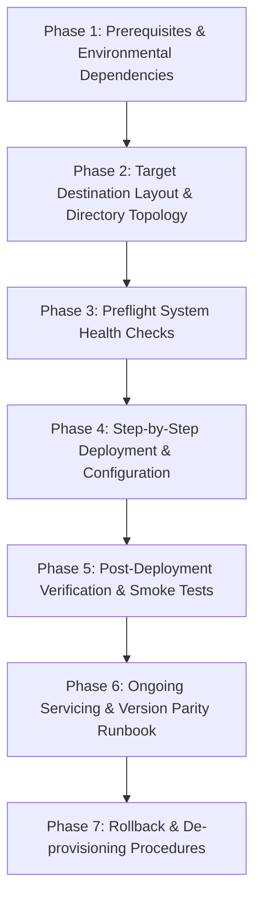

# LCM_Inventory Operational Installation & Lifecycle Runbook

Module: install/Installation.md  
Purpose: Authoritative 7-phase operational installation, configuration, health verification, update, and rollback runbook for LCM_Inventory.  
Path: LCM_Inventory/install/Installation.md  
Authors: Rolf, LCM_AI Engine  
Version: 10.2.0  
Status: Authoritative Standard  
Date: 2026-11-10  

---

## 1. Operational Overview

`LCM_Inventory` is the central configuration management, proposal ledger, tool catalog, and review dispatch engine of the Lifecycle Model (LCM) multi-repository architecture. This runbook establishes the normative 7-phase procedural lifecycle conforming to `RULE-DOC-004`.



---

## Phase 1: Prerequisites & Environmental Dependencies

Before deploying or initializing `LCM_Inventory`, verify the following host and runtime dependencies:

1. **Operating System**: Windows 11 (64-bit) or Windows Server 2022+.
2. **PowerShell Engine**: PowerShell 7+ (`pwsh.exe`) required. Windows PowerShell 5.1 is permitted only for backwards-compatible batch launcher shims (`Cmd/*.cmd`).
3. **Execution Privilege**: Normal non-elevated user session by default (`RULE-ELEV-001`). Administrative elevation is strictly delegated to designated elevation wrappers (`Invoke-ElevatedDaemon.ps1`, `Elevate-Runner.ps1`).
4. **Git Version Control**: `git.exe` 2.40+ registered in `$env:PATH`.
5. **Beyond Compare 5**: Beyond Compare 5 installed at `C:\Program Files\Beyond Compare 5\BCompare.exe` (required for BCR review gating).
6. **Network & Daemon Port**: Local loopback TCP port `9876` unblocked for the LCM Desktop REST Bridge Daemon.
7. **Optional Cloud Ingress**: Google Drive for Desktop mapped to `D:\GDrive` for external Gemini Cloud Inbox intake (`D:\GDrive\LCM\INBOX`).

---

## Phase 2: Target Destination Layout & Directory Topology

`LCM_Inventory` enforces a clean separation between public entrypoints, internal execution modules, configuration manifests, and persistent data:

```
D:\Git_Repositories\LCM_Inventory\
├── Cmd\                               # Public Windows Batch trampolines / launcher shims
│   ├── ShowCM.cmd                     # Launch LCM Control Hub
│   ├── ToolExplorer.cmd               # Launch Tool Explorer
│   └── SyncGeminiInbox.cmd            # Ingest external inbox items
├── tools\                             # Direct PowerShell operational scripts
│   ├── Show-LcmControl.ps1            # Control Hub launcher
│   ├── Show-ToolsExplorer.ps1         # Tool Explorer launcher
│   ├── Sync-LcmCatalogMacros.ps1      # Catalog-to-macro synchronizer (CRP-280)
│   ├── Process-LcmInbox.ps1           # Two-phase inbox intake processor (CRP-263)
│   └── Test-DocumentationCompleteness.ps1 # Doc auditor (CRP-267)
├── modules\                           # Reusable PowerShell modules
│   ├── ProposalManager.psm1           # Ledger and lifecycle governance
│   ├── InboxWatcher.psm1              # Two-phase inbox acknowledgement engine
│   ├── RepositoryIndexManager.psm1    # Multi-repo index manager
│   └── LcmDaemon\                     # REST Bridge Daemon module
├── config\                            # Configuration manifests
│   ├── tool_catalog.json              # Authoritative catalog of tools and macros
│   └── config.json                    # Workspace environment baseline settings
├── data\                              # Governed persistent evidence and stores
│   ├── proposals\proposals.json       # Canonical proposal ledger
│   ├── inbox_ack\                     # Two-phase inbox acknowledgement records
│   └── logs\lcm\                      # Audit execution logs
├── install\                           # Operational runbooks (RULE-DOC-004)
│   └── Installation.md                # This authoritative runbook
└── tests\                             # Automated Pester test suites
```

---

## Phase 3: Preflight System Health Checks

Run the preflight health checks to ensure environmental readiness prior to staging:

```powershell
# 1. Verify PowerShell 7+
if ($PSVersionTable.PSVersion.Major -lt 7) {
    throw "Preflight Failure: PowerShell 7+ (pwsh) is required. Current: $($PSVersionTable.PSVersion)"
}

# 2. Verify Git accessibility
git --version
if ($LASTEXITCODE -ne 0) { throw "Preflight Failure: git.exe is not accessible." }

# 3. Verify Beyond Compare 5 installation
$bcPath = "C:\Program Files\Beyond Compare 5\BCompare.exe"
if (-not (Test-Path -LiteralPath $bcPath)) {
    Write-Warning "Beyond Compare 5 not found at $bcPath. BCR review gating will fail closed until installed."
}

# 4. Verify Local REST Daemon Port 9876 is free
$portInUse = Get-NetTCPConnection -LocalPort 9876 -ErrorAction SilentlyContinue
if ($null -ne $portInUse) {
    Write-Host "Port 9876 currently occupied by PID: $($portInUse.OwningProcess)" -ForegroundColor Yellow
}
```

---

## Phase 4: Step-by-Step Deployment & Configuration

Follow these steps to deploy and configure `LCM_Inventory`:

1. **Clone or Verify Workspace Location**:
   Ensure `LCM_Inventory` is located at `D:\Git_Repositories\LCM_Inventory`.
   ```powershell
   Set-Location 'D:\Git_Repositories\LCM_Inventory'
   ```

2. **Verify Shared Rule Junction**:
   Verify `.agents/rules` correctly points to the canonical rules hub (`LCM_AI/.agents/rules`):
   ```powershell
   Test-Path '.agents/rules/InvariantRules.md'
   ```

3. **Validate Tool Catalog Manifest**:
   Audit the integrity of `config/tool_catalog.json`:
   ```powershell
   pwsh -File tools/Test-ToolCatalog.ps1
   ```

4. **Synchronize Show* Command Macros**:
   Ensure all active catalog Show* tools are reflected in `.agents/rules/macro-definitions.md`:
   ```powershell
   pwsh -File tools/Sync-LcmCatalogMacros.ps1
   ```

5. **Ensure Runtime Data Directories Exist**:
   ```powershell
   $dirs = @('data/proposals', 'data/inbox_ack', 'data/logs/lcm', 'scratch')
   foreach ($d in $dirs) {
       if (-not (Test-Path $d)) { New-Item -ItemType Directory -Path $d -Force | Out-Null }
   }
   ```

---

## Phase 5: Post-Deployment Verification & Smoke Tests

Verify system health and component integrity through standard test commands:

1. **Execute LCM Readiness Test**:
   ```powershell
   pwsh -File tools/Show-LCM_Readiness.ps1
   ```

2. **Run Automated Test Suite (Pester)**:
   ```powershell
   Invoke-Pester -Path tests/ -Output Detailed
   ```

3. **Verify Tool Catalog Synchronizer**:
   ```powershell
   pwsh -File tools/Sync-LcmCatalogMacros.ps1 -SubAction Validate
   ```

4. **Verify Documentation Completeness**:
   ```powershell
   pwsh -File tools/Test-DocumentationCompleteness.ps1 -Repositories LCM_Inventory
   ```

5. **Control Hub Smoke Test**:
   ```powershell
   pwsh -File tools/Show-LcmControl.ps1 -NoLaunch
   ```

---

## Phase 6: Ongoing Servicing & Update Runbook

When servicing `LCM_Inventory` or pulling updates:

1. **Working Tree Cleanliness**:
   Ensure no uncommitted changes exist prior to pulling:
   ```powershell
   git status --short
   ```

2. **Major Version Parity (`RULE-DOC-005`)**:
   When transitioning major versions ($M.Y.Z$), ensure version parity across headers, manifests, and DOX blocks:
   ```powershell
   # Check version alignment across modules and tools
   Get-ChildItem -Recurse -Filter '*.psm1' | Select-String -Pattern 'Version:\s*([0-9]+\.[0-9]+\.[0-9]+)'
   ```

3. **Tool Catalog Refresh**:
   Whenever adding new tools or updating parameter contracts:
   ```powershell
   pwsh -File tools/Update-ToolCatalog.ps1
   pwsh -File tools/Sync-LcmCatalogMacros.ps1
   ```

4. **Log Rotation & Pruning**:
   Audit logs in `data/logs/lcm/` older than 30 days may be compressed into archives. Never delete the current active session log.

---

## Phase 7: Rollback & De-provisioning Procedures

If deployment or updates encounter critical regressions:

1. **Stop Background Daemons & Watchers**:
   ```powershell
   Get-Process -Name pwsh | Where-Object { $_.CommandLine -like '*Show-LcmDaemon.ps1*' -or $_.CommandLine -like '*Sync-GeminiInbox.ps1*' } | Stop-Process -Force
   ```

2. **Clean Scratch State**:
   ```powershell
   if (Test-Path 'scratch') {
       Remove-Item -Path 'scratch/*' -Recurse -Force -ErrorAction SilentlyContinue
   }
   ```

3. **Revert Uncommitted File Changes**:
   ```powershell
   git restore .
   git clean -fd -e data/proposals/ -e data/inbox_ack/
   ```

4. **Preservation Invariant**:
   Never purge or wipe `data/proposals/proposals.json` or `data/inbox_ack/` during uninstallation or rollback; these contain permanent governance receipts and lifecycle state.
